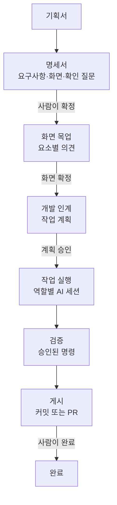

> DevRoster 개발기 시리즈의 첫 글입니다. 전체 목록은 [시리즈 목차](/posts/devroster-series/)에 있습니다.
{: .prompt-info }

DevRoster는 기획서 한 장에서 시작한다. 거기서 명세서가 나오고, 화면 목업이 나오고, 개발 작업이 나오고, 검증과 게시까지 이어진다. 전 과정을 Claude Code, Codex, Gemini CLI, 그리고 여러 API 모델에 나눠 맡기는 로컬 작업대다. 내 컴퓨터의 `127.0.0.1`에서만 열리는 웹 화면과 CLI로 돌아가고, 서버도 계정도 필요 없다.

공개 저장소: <https://github.com/edcs960/devroster>

## AI는 코드를 잘 쓰는데, 그 바깥에서 막힌다

AI 코딩 도구로 실제 프로젝트를 굴려 보면 코드 작성 실력보다 다른 데서 먼저 걸린다.

무엇을 만들지가 흐려지는 게 첫 번째다. 요구사항을 대화로 주고받다 보면 스무 턴 전에 정한 게 어디로 갔는지 모르게 되고, 빈 곳은 AI가 그럴듯한 추측으로 메운다. 추측이 틀렸다는 건 한참 뒤에 알게 된다.

두 번째는 경계다. 지금 하는 작업에서 어디까지 고쳐도 되는지 정해져 있지 않으니, 작업 범위 밖 파일을 건드리거나 설정과 비밀값에 손을 대도 막을 장치가 없다.

세 번째는 "됐다"의 기준이다. AI가 테스트를 통과했다고 말해도, 실제로 무엇을 실행했는지 어디에도 남지 않는다. 믿어도 되는 말인지 확인할 방법이 없다.

네 번째는 도구마다 규칙이 다르다는 것이다. Claude와 Codex와 Gemini는 설정 파일도, 로그인 방식도, 권한 모델도 전부 다르다. 같은 규칙을 셋에게 동시에 지키게 하는 게 일이다.

그래서 "AI가 일하고 사람이 승인한다"를 기본값으로 두는 흐름을 앱 하나로 묶었다.

## 한 번 돌려 보면 이렇게 흐른다

Studio에 기획서를 넣으면 요구사항(`REQ-…`)과 화면(`SCR-…`), 확인 질문, 명세 문서가 나온다. 이때 요구사항마다 기획서의 어느 문장에서 나왔는지 원문 근거를 붙인다. 근거를 찾지 못하면 아예 저장하지 않는다. 근거 없는 요구사항은 나중에 아무도 반박할 수 없기 때문이다. 확인 질문에 전부 답해야 명세서를 확정할 수 있고, 확정된 명세로 목업을 만든 뒤 화면 요소마다 의견을 달아 다시 생성한다.

확정된 기획을 개발 인계하면 작업 계획이 나온다. 작업마다 고쳐도 되는 경로, 연결된 요구사항, 완료를 확인할 검증 명령이 붙는다. 계획을 승인하는 순간 그 작업의 실행 조건, 그러니까 역할과 모델, 규칙, 허용 경로, 검증 명령이 스냅샷으로 고정된다. 나중에 설정을 바꿔도 이미 승인한 작업은 그대로다.

작업은 작업 전용 git worktree에서 역할별 AI 세션으로 돈다. 역할 정책 밖의 파일을 건드리면 되돌린다. 완료 여부는 AI의 말이 아니라 승인된 검증 명령의 실제 실행 결과로 판단한다. 게시는 기본이 로컬 브랜치 커밋이고, 내가 완료를 승인할 때 기본 브랜치에 병합한다. GitHub PR과 CI를 거치는 방식도 고를 수 있다.

## 타협하지 않은 것들

**표준 라이브러리만 쓴다.** 실행에 필요한 외부 패키지가 하나도 없다. 웹 서버는 `http.server`, 저장소는 SQLite다. 설치 단계를 줄이는 것도 목적이지만, 의존성 공급망에서 생기는 위험과 버전 충돌을 아예 안 만드는 쪽이 컸다. 화면은 빌드 도구 없는 HTML·CSS·JavaScript로 짰고, CSP로 인라인 스크립트와 스타일을 막았다.

**모든 상태는 내 컴퓨터에 둔다.** 설정과 DB는 프로젝트 안 `.agent-dev/`나 앱 관리 폴더에, 산출물은 `output/`에 남는다. AI 제공자 쪽으로 나가는 건 기획서, 명세, 역할 지시, 작업에 필요한 코드뿐이다.

**승인은 내용에 묶는다.** 설계 승인도, 계획 승인도, 훅 승인도 "무엇을 승인했는지"의 digest에 묶여 있다. 승인한 뒤 내용이 한 글자라도 바뀌면 그 승인은 효력을 잃고 다시 물어본다. 승인 버튼을 누른 시점과 실제로 실행되는 시점 사이에 내용이 달라질 수 있는 구조는 만들지 않았다.

**숫자로 확인한다.** 테스트는 2,100개가 넘고, Linux·macOS·Windows에서 Python 3.11과 3.14로 돌린다. 화면은 브라우저 테스트로 따로 확인한다.

## 혼자 만들지만 혼자 쓰지는 않는다

DevRoster는 나 혼자 만드는 프로젝트다. 대신 개발 자체는 AI 코딩 에이전트(Claude Code)와 같이 한다. 기능 요청과 설계 결정, 우선순위는 내가 정하고, 에이전트가 구현과 검증을 맡고, 커밋과 PR 리뷰·병합은 내가 한다. 이 시리즈에 적는 규칙과 판단 이유는 대부분 그 과정에서 "이건 규칙으로 만들어야겠다" 싶었던 것들이다.

- 다음: [구조를 지키는 법: 층 규칙을 테스트로 만들기](/posts/devroster-02-architecture/)
