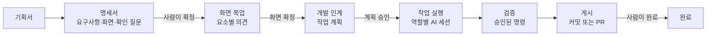

> DevRoster 개발기 시리즈의 첫 글입니다. 전체 목록은 [시리즈 목차](/posts/devroster-series/)에 있습니다.
{: .prompt-info }

## 한 줄 소개

**DevRoster**는 기획서 한 장에서 시작해 명세서, 화면 목업, 개발 작업, 검증, 게시까지를 여러 AI 코딩 도구(Claude Code, Codex, Gemini CLI, 그리고 여러 API 모델)로 진행하는 **로컬 작업대**입니다. 내 컴퓨터의 `127.0.0.1`에서만 열리는 웹 화면과 CLI로 동작하고, 서버나 계정이 필요 없습니다.

공개 저장소: <https://github.com/edcs960/devroster>

## 왜 만들었나

AI 코딩 도구는 코드를 잘 씁니다. 그런데 실제 프로젝트에 쓰려고 하면 코드 작성 바깥의 문제가 먼저 막힙니다.

- **무엇을 만들지가 흐립니다.** 대화로 요구사항을 주고받다 보면 초기 결정이 흐려지고, AI는 빈 곳을 그럴듯한 추측으로 채웁니다.
- **어디까지 고쳐도 되는지 정해져 있지 않습니다.** 작업 범위 밖 파일을 고치거나, 설정과 비밀값을 건드려도 막을 장치가 없습니다.
- **"됐다"의 기준이 없습니다.** AI가 테스트를 통과했다고 말해도, 실제로 무엇을 실행했는지 남지 않습니다.
- **도구마다 규칙이 다릅니다.** Claude와 Codex와 Gemini는 설정 파일, 로그인, 권한 모델이 모두 달라 같은 규칙을 지키게 하기 어렵습니다.

그래서 "AI가 일하고 사람이 승인한다"를 기본값으로 둔 흐름을 하나의 앱으로 만들었습니다.

## 전체 흐름

1. **Studio**에서 기획서를 넣으면 AI가 요구사항(`REQ-…`), 화면(`SCR-…`), 확인 질문과 명세 문서를 만듭니다. 요구사항마다 기획서의 어느 문장에서 나왔는지 원문 근거를 붙이고, 근거를 찾을 수 없으면 저장하지 않습니다.
2. 확인 질문에 모두 답해야 명세서를 **확정**할 수 있습니다. 확정된 명세로 화면 목업을 만들고, 화면 요소마다 의견을 남겨 다시 생성합니다.
3. 확정된 기획을 **개발 인계**하면 작업 계획이 만들어집니다. 작업마다 고쳐도 되는 경로, 연결된 요구사항, 완료를 확인할 검증 명령이 붙습니다.
4. 계획을 승인하는 순간 그 작업의 실행 조건(역할, 모델, 규칙, 허용 경로, 검증 명령)이 **스냅샷으로 고정**됩니다. 나중에 설정을 바꿔도 이미 승인한 작업은 바뀌지 않습니다.
5. 작업은 작업 전용 git worktree에서 역할별 AI 세션으로 실행됩니다. 역할 정책 밖의 파일 변경은 되돌립니다.
6. 완료 여부는 AI의 말이 아니라 **승인된 검증 명령의 실제 실행 결과**로 판단합니다.
7. 게시는 기본적으로 로컬 브랜치 커밋이고, 사용자가 완료를 승인할 때 기본 브랜치에 병합합니다. GitHub PR과 CI를 거치는 방식도 고를 수 있습니다.

## 설계에서 고집한 것

### Python 표준 라이브러리만으로

DevRoster는 실행에 필요한 외부 패키지가 없습니다. 웹 서버도 `http.server`, 저장소도 SQLite입니다. 설치 단계를 줄이고, 의존성 공급망에서 생기는 위험과 버전 충돌을 피하고 싶었습니다. 화면은 빌드 도구 없는 HTML·CSS·JavaScript이고, CSP로 인라인 스크립트와 스타일을 막습니다.

### 모든 상태는 내 컴퓨터에

설정과 DB는 프로젝트 안 `.agent-dev/` 또는 앱 관리 폴더에, 산출물은 `output/`에 남습니다. AI 제공자로 가는 것은 기획서, 명세, 역할 지시, 작업에 필요한 코드뿐입니다.

### 승인은 내용에 묶는다

설계 승인, 계획 승인, 훅 승인 모두 "무엇을 승인했는지"의 digest에 묶입니다. 승인한 뒤 내용이 바뀌면 승인은 효력을 잃고 다시 확인해야 합니다.

### 숫자로 확인한다

테스트는 2,100개가 넘고, Linux·macOS·Windows에서 Python 3.11과 3.14로 돌립니다. 브라우저 테스트로 화면도 확인합니다.

## 개발 방식

DevRoster는 저 혼자 만들지만, 개발 자체도 AI 코딩 에이전트(Claude Code)와 함께 합니다. 기능 요청, 설계 결정, 우선순위는 제가 정하고, 에이전트는 구현과 검증을 맡고, 커밋과 PR 리뷰·병합은 제가 합니다. 이 시리즈에는 그 과정에서 정한 규칙과 판단 이유를 담으려고 합니다.

## 다음 글

다음 글에서는 코드 구조 이야기를 합니다. 층 규칙을 문서로만 두었다가 생긴 일과, 그것을 테스트로 바꾼 방법입니다.

- 다음: [구조를 지키는 법: 층 규칙을 테스트로 만들기](/posts/devroster-02-architecture/)
