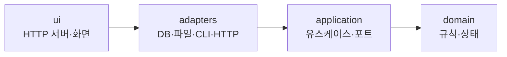

> DevRoster 개발기 시리즈입니다. 전체 목록은 [시리즈 목차](/posts/devroster-series/)에 있습니다.
{: .prompt-info }

## 처음엔 문서 한 장이었다

DevRoster 코드는 네 층으로 나뉜다.



규칙은 딱 하나였다. 바깥 층이 안쪽 층을 부르고, 거꾸로는 부르지 않는다. 이 문장은 저장소의 규칙 문서(`.ai/rules/project.md`)에 적혀 있었고, AI 에이전트도 그 문서를 읽고 일했다. 그러니까 규칙은 있었고, 읽는 사람도 있었다.

## 세어 봤더니

몇 달 붙이고 나서 구조를 한 번 점검했다. import를 직접 세 보니 안쪽 두 층은 깨끗했다. `domain`은 `domain`만, `application`은 `domain`과 포트만 import하고 있었다. 문제는 그 위였다.

| 패키지 | 줄 수 |
|---|---:|
| domain | 3,132 |
| application | 1,718 |
| **adapters** | **30,052** |
| ui | 2,810 |

전체 코드의 70%가량이 `adapters`에 몰려 있었다. 그 안에는 DB 입출력만 있는 게 아니라 추적성 계산이나 요구사항 변경 같은 업무 규칙도 같이 살고 있었다. 한 파일에 다 넣다 보니 1,000줄이 넘는 파일이 다섯 개까지 나왔다.

층 규칙도 이미 새고 있었다. `adapters`가 `ui`를 import하는 곳이 5곳이었는데, CLI 명령이 웹 서버를 직접 띄우고 있었고 Slack 연동이 웹 계층을 거쳐 Studio를 불렀다. `ui`가 데스크톱 실행기(`app.py`)를 import하는 곳도 1곳, 다른 모듈의 `_`로 시작하는 비공개 함수를 끌어다 쓰는 곳이 7곳이었다. 함수 안에서 import하는 곳은 파일 상단에서 하는 곳보다 많았다(362곳 대 313곳). 순환 의존을 이렇게 숨긴 경우도 있었다.

문서에 적힌 규칙은 지켜지지 않는다는 걸 숫자로 확인한 셈이다. 사람도 AI도 급할 때는 제일 가까이 있는 함수를 import한다. 그게 규칙을 어기는 길이어도, 일단 돌아가게 하는 쪽이 먼저 보인다.

## 규칙을 실행되는 것으로 옮겼다

그래서 규칙을 테스트로 옮겼다. 파이썬 표준 라이브러리 `ast`로 모든 모듈의 import를 모아서 층 지도와 비교한다.

```python
LAYERS = {
    "domain": "domain",
    "application": "application", "ports": "application",
    "adapters": "adapters", "core": "adapters", "runners": "adapters", ...,
    "ui": "ui",
    "app": "bootstrap", "entrypoints": "bootstrap", ...,
}
ALLOWED = {
    "domain": {"domain"},
    "application": {"application", "domain"},
    "adapters": {"adapters", "application", "domain"},
    "ui": {"ui", "adapters", "application", "domain"},
    "bootstrap": {"bootstrap", "ui", "adapters", "application", "domain"},
}
```
{: file="tests/test_architecture.py (요약)" }

만들면서 신경 쓴 건 세 가지다.

먼저 숨은 import까지 찾아야 한다. 파일 상단만 보면 반쪽이다. 함수 안의 import, 상대 import(`from .x import y`), `__import__("agent_dev....")` 같은 동적 import, `from agent_dev import defaults`처럼 패키지에서 모듈을 꺼내는 경우까지 모은다. 그리고 이런 경우를 실제로 잡아내는지 확인하는 테스트를 따로 붙였다. 검사기가 검사하는지도 검사해야 한다.

그리고 새 패키지는 층을 정해야 한다. 층 지도에 없는 최상위 패키지가 생기면 테스트가 실패한다. "이 코드는 어느 층인가"를 나중이 아니라 만드는 순간에 결정하게 된다.

마지막으로 남은 위반은 줄어들기만 해야 한다. 처음부터 위반을 다 고칠 수는 없으니, 그 시점에 있던 위반은 이유를 적어 예외 목록에 넣었다. 대신 위반을 고치면 목록에서도 지워야 테스트가 통과한다.

```python
new = sorted(seen - set(KNOWN_LAYER_EXCEPTIONS))
assert not new, f"층 방향을 거스르는 import: {new}"
fixed = sorted(set(KNOWN_LAYER_EXCEPTIONS) - seen)
assert not fixed, f"고쳐졌으니 예외 목록에서 지우세요: {fixed}"
```

목록을 그대로 두고 고치면 테스트가 실패한다. 안 지우면 나중에 같은 위반이 다시 들어와도 목록에 있으니 조용히 지나가기 때문이다. 예외 목록을 "지금 상태의 사본"이 아니라 줄여야 할 목록으로 만든 게 이 검사의 핵심이다.

테스트가 진짜 실패하는지도 확인했다. `domain`에 일부러 `adapters` import를 넣으면 실패하고, 층이 없는 패키지를 만들면 실패한다.

## 예외 6건을 0으로

남은 예외는 6건이었고, 대부분 "누가 앱을 조립하는가"가 정해져 있지 않아서 생긴 것이었다. CLI 명령을 해석하는 `command_line.py`(adapters)가 웹 서버까지 직접 띄우고 있었던 게 대표적이다.

해결은 의존을 거꾸로 주입하는 것이었다. 모든 층을 알아도 되는 진입점(bootstrap)이 웹 서버를 시작하는 함수를 CLI에 넘긴다.

```python
# entrypoints.py (bootstrap)
register_web_servers({
    "studio": lazy("agent_dev.ui.studio_server"),
    "dashboard": lazy("agent_dev.ui.dashboard"),
    "setup": lazy("agent_dev.ui.setup_server"),
})
```

나머지도 같은 원칙으로 정리했다. 작업 상태를 사람이 읽는 문구로 바꾸는 표는 `ui`에 있었는데 Slack 메시지도 그 표를 썼다. 둘 다 쓰는 거라 안쪽(`domain`)으로 내렸다. Slack 연동은 웹 계층을 거치지 않고 Studio 서비스를 직접 쓰게 했고, "처음 열 화면"을 정하는 일은 실행기에서 `ui`로 옮겼다. 조립하는 쪽이 아래층을 알수록 위층은 몰라도 되는 방향으로 밀었다.

이 정리를 하다가 버그도 하나 나왔다. Slack으로 "요청"을 보내면 Studio 생성 작업을 `"spec"` 종류로 시작하고 있었는데, Studio가 받는 건 `"specs"`다. 테스트가 가짜 Studio를 쓰고 있었기 때문에 그동안 아무도 몰랐다. 지금은 실제 Studio 서비스로 확인하는 테스트가 있다.

그렇게 층 규칙 예외는 0건이 됐다.

## 남은 건 3만 줄이다

규칙은 문서가 아니라 테스트에 있어야 지켜진다. AI 에이전트와 같이 일할 때는 특히 그렇다. 에이전트는 문서를 읽지만, 실패하는 테스트는 무시하지 못한다.

그리고 한 번에 다 고치려고 하면 못 고친다. 늘어나지 않게 먼저 막고, 고칠 때마다 목록에서 지우는 방식이 제일 효과가 좋았다.

마지막으로, 구조 문제는 결국 보안 문제로 이어진다. 4편에서 다루지만, 그때 가장 심각했던 보안 문제는 "작업 공간 위치를 판단하는 코드가 다섯 곳에 흩어져 있다"는 구조 문제에서 나왔다. 흩어진 판단은 한 곳을 막아도 다른 곳이 열려 있다.

`adapters` 3만 줄에서 업무 규칙을 안쪽으로 옮기는 일은 아직 남았다. 한 번에 하지 않고, 기능을 고칠 때마다 그 기능의 규칙을 조금씩 내리는 중이다.

- 이전: [DevRoster는 무엇이고 왜 만들었나](/posts/devroster-01-intro/)
- 다음: [Claude·Codex·Gemini·K-EXAONE를 한 흐름으로](/posts/devroster-03-multi-ai/)
