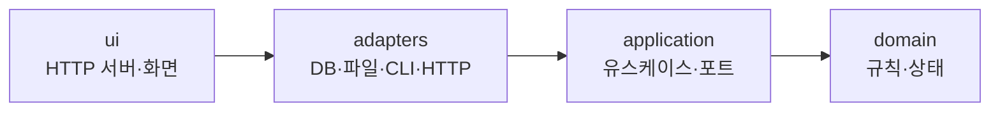

> DevRoster 개발기 시리즈입니다. 전체 목록은 [시리즈 목차](/posts/devroster-series/)에 있습니다.
{: .prompt-info }

## 처음 정한 규칙

DevRoster의 코드는 네 개 층으로 나뉩니다.



규칙은 하나였습니다. **바깥 층이 안쪽 층을 부르고, 거꾸로 부르지 않는다.** 이 규칙은 저장소의 규칙 문서(`.ai/rules/project.md`)에 적혀 있었고, AI 에이전트도 그 문서를 읽고 일했습니다.

## 점검해 보니

몇 달 동안 기능을 붙인 뒤 구조를 점검했습니다. import를 직접 세어 보니 안쪽 두 층은 깨끗했습니다. `domain`은 `domain`만, `application`은 `domain`과 포트만 import하고 있었습니다.

문제는 `adapters`였습니다.

| 패키지 | 줄 수 |
|---|---:|
| domain | 3,132 |
| application | 1,718 |
| **adapters** | **30,052** |
| ui | 2,810 |

전체 코드의 약 70%가 `adapters`에 있었고, 추적성 계산이나 요구사항 변경 같은 업무 규칙도 DB 입출력과 한 파일에 섞여 있었습니다. 1,000줄이 넘는 파일이 다섯 개였습니다. 층 규칙 위반도 있었습니다.

- `adapters`가 `ui`를 import하는 곳 5곳 (CLI 명령이 웹 서버를 직접 띄우고, Slack 연동이 웹 계층을 통해 Studio를 부름)
- `ui`가 데스크톱 실행기(`app.py`)를 import하는 곳 1곳
- 다른 모듈의 `_`로 시작하는 비공개 함수를 가져다 쓰는 곳 7곳
- 함수 안에서 import하는 곳이 파일 상단보다 많음 (362곳 대 313곳). 순환 의존을 이렇게 숨긴 경우도 있었음

규칙이 문서에만 있으면 지켜지지 않는다는 것을 숫자로 확인한 셈입니다. 사람도 AI도, 급할 때는 가장 가까운 함수를 import합니다.

## 규칙을 테스트로 바꾸기

그래서 규칙을 테스트로 만들었습니다. 파이썬 표준 라이브러리 `ast`로 모든 모듈의 import를 모으고, 층 지도와 비교합니다.

```python
LAYERS = {
    "domain": "domain",
    "application": "application", "ports": "application",
    "adapters": "adapters", "core": "adapters", "runners": "adapters", ...,
    "ui": "ui",
    "app": "bootstrap", "entrypoints": "bootstrap", ...,
}
ALLOWED = {
    "domain": {"domain"},
    "application": {"application", "domain"},
    "adapters": {"adapters", "application", "domain"},
    "ui": {"ui", "adapters", "application", "domain"},
    "bootstrap": {"bootstrap", "ui", "adapters", "application", "domain"},
}
```
{: file="tests/test_architecture.py (요약)" }

신경 쓴 부분은 세 가지입니다.

**1. 숨은 import까지 찾는다.** 파일 상단만 보면 안 됩니다. 함수 안의 import, 상대 import(`from .x import y`), `__import__("agent_dev....")` 같은 동적 import, `from agent_dev import defaults`처럼 패키지에서 모듈을 꺼내는 경우까지 모읍니다. 그리고 이 경우들을 실제로 찾아내는지 확인하는 테스트도 따로 둡니다.

**2. 새 패키지는 층을 정해야 한다.** 층 지도에 없는 최상위 패키지가 생기면 테스트가 실패합니다. "이 코드는 어느 층인가"를 만드는 순간 결정하게 됩니다.

**3. 남은 위반은 줄어들기만 한다.** 처음부터 모든 위반을 고칠 수는 없어서, 지금 있는 위반은 이유와 함께 예외 목록에 넣었습니다. 대신 위반을 고치면 목록에서도 지워야 테스트가 통과합니다. 고쳐 놓고 목록을 그대로 두면 다시 그 위반이 들어와도 모르기 때문입니다.

```python
new = sorted(seen - set(KNOWN_LAYER_EXCEPTIONS))
assert not new, f"층 방향을 거스르는 import: {new}"
fixed = sorted(set(KNOWN_LAYER_EXCEPTIONS) - seen)
assert not fixed, f"고쳐졌으니 예외 목록에서 지우세요: {fixed}"
```

테스트가 정말 실패하는지도 확인했습니다. `domain`에 일부러 `adapters` import를 넣으면 실패하고, 층이 없는 패키지를 만들면 실패합니다.

## 예외를 0으로: 조립 지점 정리

예외 6건은 대부분 "누가 앱을 조립하는가"가 정해져 있지 않아 생긴 것이었습니다. CLI 명령을 해석하는 `command_line.py`(adapters)가 웹 서버까지 직접 띄우고 있었습니다.

해결은 의존을 거꾸로 주입하는 것이었습니다. 모든 층을 알아도 되는 **진입점(bootstrap)**이 웹 서버를 시작하는 함수를 CLI에 넘깁니다.

```python
# entrypoints.py (bootstrap)
register_web_servers({
    "studio": lazy("agent_dev.ui.studio_server"),
    "dashboard": lazy("agent_dev.ui.dashboard"),
    "setup": lazy("agent_dev.ui.setup_server"),
})
```

나머지도 같은 원칙으로 정리했습니다.

- 작업 상태를 사람이 읽는 문구로 바꾸는 표는 `ui`에 있었지만 Slack 메시지도 썼습니다. 안쪽(`domain`)으로 옮겨 둘이 함께 씁니다.
- Slack 연동은 웹 계층 대신 Studio 서비스를 직접 씁니다.
- "처음 열 화면" 결정은 실행기에서 `ui`로 옮겼습니다.

이 정리를 하다가 버그도 하나 찾았습니다. Slack으로 "요청"을 보내면 Studio 생성 작업을 `"spec"` 종류로 시작했는데, Studio는 `"specs"`만 받습니다. 테스트가 가짜 Studio를 썼기 때문에 그동안 아무도 몰랐습니다. 이제는 실제 Studio 서비스로 확인하는 테스트가 있습니다.

결과적으로 층 규칙 예외는 **0건**이 되었습니다.

## 배운 것

- **규칙은 문서가 아니라 테스트에 있어야 지켜진다.** AI 에이전트와 함께 개발할 때 특히 그렇습니다. 에이전트는 문서를 읽지만, 실패하는 테스트는 무시하지 못합니다.
- **한 번에 고치지 말고, 늘어나지 않게 먼저 막는다.** 예외 목록을 "줄어들기만 하는 목록"으로 만든 것이 가장 효과가 컸습니다.
- **구조 문제는 보안 문제로 이어진다.** 보안 점검 글에서 자세히 다루겠지만, 가장 심각했던 보안 문제는 "작업 공간 위치를 판단하는 코드가 다섯 곳에 흩어져 있다"는 구조 문제에서 나왔습니다.

남은 과제는 3만 줄짜리 `adapters`에서 업무 규칙을 안쪽 층으로 옮기는 일입니다. 한 번에 하지 않고, 기능을 고칠 때마다 그 기능의 규칙을 조금씩 옮기고 있습니다.

- 이전: [DevRoster는 무엇이고 왜 만들었나](/posts/devroster-01-intro/)
- 다음: [Claude·Codex·Gemini·K-EXAONE를 한 흐름으로](/posts/devroster-03-multi-ai/)
