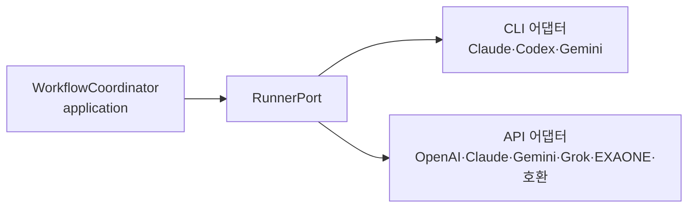

> DevRoster 개발기 시리즈입니다. 전체 목록은 [시리즈 목차](/posts/devroster-series/)에 있습니다.
{: .prompt-info }

DevRoster는 한 가지 AI에 묶이지 않습니다. 개발 CLI로 Claude Code, Codex, Gemini CLI를 쓰고, 텍스트 생성에는 OpenAI, Claude, Gemini, Grok, LG K-EXAONE API와 Ollama 같은 OpenAI 호환 서버를 씁니다. 이 글은 서로 다른 도구를 같은 규칙으로 부르기 위해 한 일들을 정리합니다.

## 두 종류의 AI 도구

| 종류 | 예 | 하는 일 |
|---|---|---|
| 개발 CLI | Claude Code, Codex, Gemini CLI | 승인된 범위 안에서 파일을 읽고 고침 |
| API 모델 | OpenAI, Claude, Gemini, Grok, K-EXAONE, 호환 서버 | 명세서·목업 같은 텍스트 생성, 텍스트 단계 |

API 모델은 파일을 직접 고치지 않습니다. 모델이 도구 호출(tool call)을 요청해도 실행하지 않고, 텍스트 결과만 받습니다. 코드를 고치는 일은 파일 권한을 통제할 수 있는 개발 CLI에만 맡깁니다.

## 개발 CLI 격리: "내 터미널의 Claude"와 분리하기

사용자 컴퓨터의 `~/.claude`, `~/.codex`, `~/.gemini`에는 개인 로그인, 플러그인, MCP 서버, 전역 지시문이 들어 있습니다. DevRoster가 이것을 그대로 쓰면 작업 결과가 사용자마다 달라지고, 의도하지 않은 도구가 작업에 끼어듭니다.

그래서 DevRoster는 **앱 전용 CLI 홈**을 씁니다.

```text
CLAUDE_CONFIG_DIR → <앱 관리 폴더>/cli/claude
CODEX_HOME        → <앱 관리 폴더>/cli/codex
GEMINI_CLI_HOME   → <앱 관리 폴더>/cli/gemini
```

로그인도 이 홈에 따로 합니다. 그 위에 도구마다 끌 수 있는 것을 끕니다.

- **Claude Code**: `--strict-mcp-config`로 DevRoster가 넘긴 MCP만 쓰고, `--setting-sources ""`로 사용자·프로젝트 설정을 읽지 않으며, `--tools`로 역할에 필요한 도구(읽기 전용 역할은 Read·Grep·Glob)만 허용합니다.
- **Codex**: 역할에 따라 `workspace-write` 또는 `read-only` 샌드박스, `project_doc_max_bytes=0`으로 저장소의 `AGENTS.md`를 지시로 합치지 않음.
- **Gemini CLI**: 시스템 설정과 admin 정책으로 MCP·훅·확장을 끄고, 정책을 보장할 수 없는 환경이면 실행하지 않음.

개발 대상 저장소의 `CLAUDE.md`, `AGENTS.md`를 지시로 읽지 않는 이유는 단순합니다. 저장소 안의 문서는 저장소를 만든 사람이 쓴 것이고, 그 내용이 AI의 권한을 넓히면 안 되기 때문입니다. 규칙은 DevRoster가 작업 승인 시점에 고정해서 모든 AI에 같은 내용으로 전달합니다.

## 같은 계약으로 부르기

도구가 달라도 DevRoster 안에서는 같은 계약을 씁니다. 실행 요청(`PhaseRequest`)에는 작업, 단계, 승인 스냅샷 digest, 허용 능력(`code.read`, `code.write`, `text.generate`)이 들어가고, 결과(`PhaseResult`)에는 출력, 제공자, 토큰 사용량, 선택된 모델이 돌아옵니다.



실행 흐름을 조정하는 코드는 포트만 알고, 어떤 도구가 실제로 일하는지는 모릅니다. 새 제공자를 추가할 때 바뀌는 곳은 어댑터와 설정뿐입니다.

### 사례: K-EXAONE API 추가

LG AI Research가 K-EXAONE 2.5 API를 공개했을 때 하루 안에 추가했습니다. API가 OpenAI 호환 Chat Completions라 기존 경로를 재사용할 수 있었고, 모델 특성만 반영했습니다.

- 이 모델은 항상 추론한 뒤 답하고, 추론 토큰이 `max_tokens`에 포함됩니다. 다른 API의 기본 출력 상한(16,384)으로는 답이 잘릴 수 있어 32,768을 기본으로 둡니다.
- 추론 강도는 `low`·`high`·`max`만 지원합니다. `medium`이나 `xhigh`를 저장하려 하면 설정 단계에서 거부합니다. 조용히 무시하지 않는 것이 원칙입니다.
- 응답의 추론 과정(`reasoning_content`)은 결과에 넣지 않고 답변만 씁니다.

## 모델과 추론 강도 고르기

작업마다 모델을 고정할 수도 있고, 작업 크기와 역할에 따라 자동으로 고르게 할 수도 있습니다. 자동 선택은 균형형이라 추론 강도를 `high` 이상으로 올리지 않습니다. 실패했다고 더 비싼 모델로 자동 재시도하지도 않습니다. 비용이 예측 가능해야 하기 때문입니다.

## 역할 세션: 호출 수 줄이기

작업은 여러 역할(설계, 개발, 테스트, 문서 등)이 순서대로 진행합니다. 역할마다 AI를 따로 부르면 호출이 많아지고, 매번 저장소를 다시 읽느라 토큰이 낭비됩니다. 그래서 같은 모델을 쓰는 연속된 역할은 **세션 하나로 묶어 한 번에 호출**하고, 결과를 역할별로 나눕니다. 비용은 실제로 호출한 노드 하나에만 기록해서 중복으로 세지 않습니다.

## 다른 모델로 서로 검토하기

단계 결과를 검증할 때, 결과를 만든 모델과 **다른 계열**의 모델에게 읽기 전용으로 검토를 맡길 수 있습니다. 같은 모델은 같은 실수를 같은 이유로 놓치기 쉽기 때문입니다. 계열은 OpenAI(Codex·OpenAI API), Anthropic(Claude), Google(Gemini)처럼 묶습니다. 이 아이디어는 5편에서 다루는 명세 독립 검토로 더 발전합니다.

## 배운 것

- **AI 도구를 "그대로" 쓰면 재현성이 없다.** 앱 전용 홈과 설정 차단으로 사용자 환경과 분리해야 같은 입력에 같은 조건으로 실행됩니다.
- **지원하지 않는 옵션은 거부한다.** 조용히 무시하면 사용자는 설정이 적용됐다고 믿습니다.
- **여러 모델을 쓰는 진짜 이점은 서로 검토하는 데 있다.** 성능 비교보다 사각지대를 줄이는 효과가 큽니다.

- 이전: [구조를 지키는 법: 층 규칙을 테스트로 만들기](/posts/devroster-02-architecture/)
- 다음: [AI 토큰과 비용을 숫자로 보기: 사용량 대시보드](/posts/devroster-06-usage-dashboard/)
