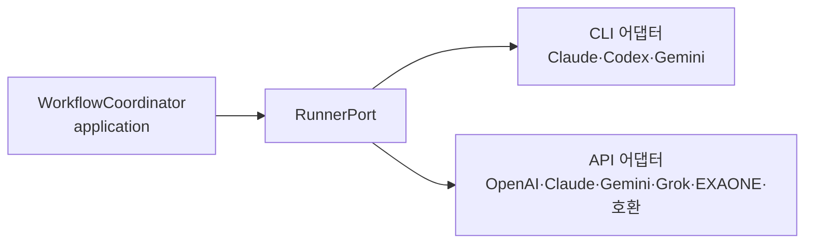

> DevRoster 개발기 시리즈입니다. 전체 목록은 [시리즈 목차](/posts/devroster-series/)에 있습니다.
{: .prompt-info }

DevRoster는 한 AI에 묶이지 않는다. 코드를 고치는 일은 Claude Code, Codex, Gemini CLI가 맡고, 글을 쓰는 일은 OpenAI·Claude·Gemini·Grok·LG K-EXAONE API와 Ollama 같은 OpenAI 호환 서버가 맡는다. 문제는 이걸 한 흐름 안에서 같은 규칙으로 부르는 일이었다.

## 두 종류를 섞지 않는다

| 종류 | 예 | 하는 일 |
|---|---|---|
| 개발 CLI | Claude Code, Codex, Gemini CLI | 승인된 범위 안에서 파일을 읽고 고침 |
| API 모델 | OpenAI, Claude, Gemini, Grok, K-EXAONE, 호환 서버 | 명세서·목업 같은 텍스트 생성, 텍스트 단계 |

API 모델은 파일을 직접 고치지 않는다. 모델이 도구 호출(tool call)을 요청해도 실행하지 않고 텍스트 결과만 받는다. 이건 성능 문제가 아니라 권한 문제다. 파일을 고치는 일은 파일 권한을 통제할 수 있는 개발 CLI에만 맡긴다.

## 내 터미널의 Claude와 분리하기

`~/.claude`, `~/.codex`, `~/.gemini`에는 개인 로그인, 플러그인, MCP 서버, 전역 지시문이 들어 있다. DevRoster가 이걸 그대로 쓰면 작업 결과가 사용자마다 달라지고, 내가 모르는 도구가 작업 중간에 끼어든다. 같은 기획서를 넣었는데 어제와 오늘 결과가 다르면 그건 도구의 문제가 아니라 실행 조건의 문제다.

그래서 앱 전용 CLI 홈을 따로 쓴다.

```text
CLAUDE_CONFIG_DIR → <앱 관리 폴더>/cli/claude
CODEX_HOME        → <앱 관리 폴더>/cli/codex
GEMINI_CLI_HOME   → <앱 관리 폴더>/cli/gemini
```

로그인도 이 홈에서 따로 한다. 그 위에 도구마다 끌 수 있는 것을 끈다.

- **Claude Code**: `--strict-mcp-config`로 DevRoster가 넘긴 MCP만 쓰게 하고, `--setting-sources ""`로 사용자·프로젝트 설정을 읽지 않게 하고, `--tools`로 역할에 필요한 도구만 허용한다(읽기 전용 역할은 Read·Grep·Glob).
- **Codex**: 역할에 따라 `workspace-write` 또는 `read-only` 샌드박스, `project_doc_max_bytes=0`으로 저장소의 `AGENTS.md`를 지시로 합치지 않는다.
- **Gemini CLI**: 시스템 설정과 admin 정책으로 MCP·훅·확장을 끄고, 정책을 보장할 수 없는 환경이면 아예 실행하지 않는다.

개발 대상 저장소의 `CLAUDE.md`, `AGENTS.md`를 지시로 읽지 않는 이유는 간단하다. 저장소 안의 문서는 저장소를 만든 사람이 쓴 것이고, 그 내용이 AI의 권한을 넓히면 안 된다. 규칙은 DevRoster가 작업 승인 시점에 고정해서 모든 AI에 같은 내용으로 전달한다. 어느 파일을 읽고 무엇을 할 수 있는지는 저장소가 아니라 승인 기록이 정한다.

## 도구가 달라도 계약은 하나

실행 요청(`PhaseRequest`)에는 작업, 단계, 승인 스냅샷 digest, 허용 능력(`code.read`, `code.write`, `text.generate`)이 들어간다. 결과(`PhaseResult`)로는 출력, 제공자, 토큰 사용량, 선택된 모델이 돌아온다. 호출하는 쪽은 이 계약만 알면 되고, 뒤에서 Claude가 답했는지 Codex가 답했는지는 상관하지 않는다.



실행 흐름을 조정하는 코드는 포트만 안다. 새 제공자를 붙일 때 바뀌는 곳은 어댑터와 설정뿐이다.

### K-EXAONE을 하루 만에 붙인 날

LG AI Research가 K-EXAONE 2.5 API를 공개했을 때 하루 안에 추가했다. API가 OpenAI 호환 Chat Completions라 기존 경로를 그대로 재사용할 수 있었고, 모델 특성만 반영하면 됐다. 다만 반영할 게 몇 개 있었다.

이 모델은 항상 추론한 뒤에 답하고, 추론 토큰이 `max_tokens`에 포함된다. 다른 API의 기본 출력 상한인 16,384로 두면 추론만 하다가 답이 잘린다. 그래서 기본값을 32,768로 잡았다.

추론 강도는 `low`·`high`·`max`만 지원한다. `medium`이나 `xhigh`를 저장하려고 하면 설정 단계에서 거부한다. 조용히 무시하고 돌리면 사용자는 설정이 적용된 줄 알고, 결과가 이상할 때 엉뚱한 데를 뒤지게 된다. 지원하지 않는 옵션은 거부하는 쪽이 낫다.

응답에 딸려 오는 추론 과정(`reasoning_content`)은 결과에 넣지 않고 답변만 쓴다. 다음 단계에 넘길 건 결론이지 사고 과정이 아니다.

## 모델은 누가 고르나

작업마다 모델을 고정할 수도 있고, 작업 크기와 역할을 보고 자동으로 고르게 할 수도 있다. 자동 선택은 균형형이라 추론 강도를 `high` 이상으로 올리지 않는다. 실패했다고 더 비싼 모델로 자동 재시도하지도 않는다. 재시도는 사람이 결정할 일이고, 비용은 예측 가능해야 한다.

## 역할 세션으로 호출 줄이기

작업은 여러 역할(설계, 개발, 테스트, 문서 등)이 순서대로 진행한다. 역할마다 AI를 따로 부르면 호출이 많아지고, 매번 저장소를 처음부터 다시 읽느라 토큰이 샌다. 그래서 같은 모델을 쓰는 연속된 역할은 세션 하나로 묶어 한 번에 부르고, 결과를 역할별로 나눈다. 비용은 실제로 호출한 노드 하나에만 기록해서 같은 일을 두 번 세지 않는다. 이 규칙 때문에 6편에서 집계 버그를 하나 만들었는데, 그 이야기는 거기서 한다.

## 다른 모델에게 검토를 맡긴다

단계 결과를 검증할 때, 결과를 만든 모델과 다른 계열의 모델에게 읽기 전용으로 검토를 맡길 수 있다. 같은 모델은 같은 실수를 같은 이유로 놓친다. 반대로 다른 회사 모델이 보면 그 모델에게는 없던 가정이 드러나기도 한다. 계열은 OpenAI(Codex·OpenAI API), Anthropic(Claude), Google(Gemini)처럼 묶어서, 같은 계열끼리는 "다른 모델"로 치지 않는다. 이 아이디어는 5편의 명세 독립 검토로 이어진다.

## 재현성, 거부, 그리고 교차 검토

AI 도구를 사용자 환경 그대로 쓰면 재현성이 없다. 앱 전용 홈과 설정 차단으로 환경을 분리해야 같은 입력에 같은 조건으로 실행된다. 처음에 이걸 귀찮은 설정 작업으로 봤는데, 실제로는 이게 있어야 "왜 어제는 됐는데"를 물을 수 있게 된다.

지원하지 않는 옵션은 거부하는 게 맞다. 그리고 여러 모델을 쓰는 진짜 이득은 성능 비교가 아니라 서로 검토하는 데 있다. 한 모델의 사각지대를 다른 계열이 메우는 쪽이 체감이 크다.

- 이전: [구조를 지키는 법: 층 규칙을 테스트로 만들기](/posts/devroster-02-architecture/)
- 다음: [로컬 앱도 공격받는다: 보안 점검과 신뢰 경계](/posts/devroster-04-security/)
