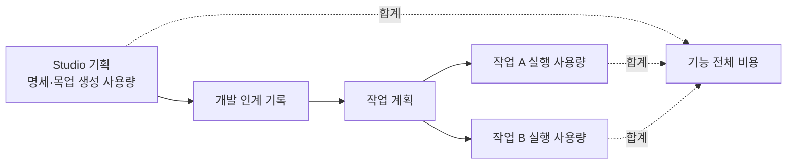

> DevRoster 개발기 시리즈입니다. 전체 목록은 [시리즈 목차](/posts/devroster-series/)에 있습니다.
{: .prompt-info }

AI로 개발하면 "이 기능 하나에 얼마나 썼지?"가 궁금해집니다. DevRoster에는 작업 하나의 사용량 카드가 있었지만, 프로젝트 전체를 합쳐 보는 화면은 없었습니다. 그래서 **사용량·진행 현황** 대시보드를 만들었고, 만드는 과정에서 집계 버그 세 가지를 찾았습니다.

## 대시보드에 담은 것

- **작업 진행(현재 기준)**: 상태별 작업 수(진행 중, 사용자 차례, 차단, 계획됨, 완료, 취소), 완료율, 주의가 필요한 순서(차단 → 사용자 차례 → 진행 중)로 정렬한 열린 작업
- **AI 사용량(7·30·90일·전체)**: 호출 수, 입력·출력·캐시 토큰, AI 실행 시간, 예상 비용(통화별), 일별 토큰 그래프
- **나눠 보기**: 도구·모델별, 역할별, 작업별, 그리고 **기획별**(Studio에서 기획을 만든 사용량 + 그 기획으로 만든 작업들의 실행 사용량)

구조는 2편의 층 규칙을 그대로 따릅니다. 합계와 분류는 입력만 받아 계산하는 순수 함수(`domain/usage_report.py`), DB 조회는 adapters, 화면은 ui에 둡니다. 계산 로직을 DB 없이 테스트할 수 있습니다.

## 찾은 버그 1: 호출이 아닌 기록을 호출로 셌다

3편에서 설명한 역할 세션은 여러 역할을 AI 호출 한 번으로 처리합니다. 실행 기록은 역할마다 남지만, 사용량은 실제로 호출한 노드 하나에만 있고 나머지는 비어 있습니다(`ai_call: false`).

작업별 비용 계산은 이 빈 기록까지 "토큰 기록 없음" 호출로 세고 있었습니다. 실제로는 호출이 한 번인데 비용을 알 수 없는 호출이 여러 번 있는 것처럼 보였습니다. 이제 세션 구성원 기록은 호출로 세지 않습니다.

## 찾은 버그 2: Claude의 캐시 토큰이 버려졌다

Claude는 결과의 사용량을 이렇게 나눠서 알려 줍니다.

```json
{"input_tokens": 40, "cache_creation_input_tokens": 5000,
 "cache_read_input_tokens": 90000, "output_tokens": 700}
```

DevRoster는 사용량을 정리할 때 `input_tokens`, `output_tokens`, `cached_input_tokens`만 남기고 있었습니다. 그래서 Claude의 캐시 읽기·쓰기 토큰이 통째로 버려졌습니다. 코딩 에이전트는 같은 저장소를 반복해서 읽기 때문에 캐시 토큰이 입력 토큰보다 훨씬 많은 경우가 흔합니다. 위 예에서 실제 처리량은 95,000토큰이 넘는데 40토큰으로 기록된 셈입니다.

이제 캐시 읽기는 `cached_input_tokens`(캐시 단가)로, 캐시 쓰기는 `input_tokens`(입력 단가)에 더해 집계합니다. 제공자마다 캐시를 세는 방식이 다르다는 점(OpenAI 계열은 캐시가 입력 안에 포함, Anthropic은 따로)도 계산에 반영합니다.

## 찾은 버그 3: 기획 단계 사용량이 아무 데도 없었다

Studio에서 기획서로 명세서와 목업을 만드는 호출은 "작업"이 아니라서 사용량이 어디에도 기록되지 않았습니다. 기능 하나의 전체 비용을 보려면 기획 단계와 개발 단계를 이어서 봐야 합니다.

그래서 Studio 생성 호출마다 사용량을 기록하고, 개발 인계 기록을 따라 **기획 → 인계 → 계획 → 작업**을 연결했습니다.



## 가격은 왜 고정해야 하나

예상 비용은 사용자가 입력한 가격표(모델별 입력·캐시·출력 단가)로 계산합니다. 실제 청구액이 아니라 추정치라는 점을 화면에 분명히 적습니다. 구독 로그인으로 쓰는 CLI는 토큰당 과금이 없으니, "API로 썼다면 들었을 금액"으로 이해하면 됩니다.

여기서 중요한 결정이 하나 있었습니다. **가격표를 나중에 바꾸면 과거 비용도 바뀌어야 할까?**

DevRoster의 개발 작업은 승인할 때 가격표까지 실행 조건에 고정합니다. 그래서 작업 비용은 승인 시점 가격으로 계산됩니다. 그런데 Studio 생성은 승인 단계가 없어서 처음에는 "현재 가격표"로 계산했습니다. 그러면 가격을 올리는 순간 지난달 기획 비용까지 올라갑니다. 기준이 섞이면 숫자를 믿을 수 없습니다.

그래서 Studio도 생성을 시작할 때의 가격표를 잡아 두고, 호출을 기록하는 순간 비용을 계산해 함께 저장하도록 바꿨습니다. 이제 두 단계 모두 "그때의 가격"으로 계산됩니다.

## 테스트하기 어려운 것을 테스트하기

실제 Claude나 Codex를 테스트마다 호출할 수는 없습니다. 비용이 들고, 결과도 매번 다릅니다. 그렇다고 사용량 기록 경로를 검증하지 않을 수도 없습니다.

그래서 실제 CLI와 같은 형식으로 출력하는 **가짜 실행 파일**을 만들었습니다. 가짜 `claude`는 stream-json 이벤트를, 가짜 `codex`는 `--json` 이벤트와 결과 파일을 내보냅니다. 이 가짜 CLI로 Studio 명세 생성을 처음부터 끝까지 돌려서 확인합니다.

- 호출마다 사용량이 기록되는가
- Codex처럼 캐시를 입력에 포함하는 방식이 맞게 계산되는가
- 가격을 올린 뒤에도 기록된 비용이 바뀌지 않는가

남는 위험은 "실제 CLI의 출력 형식이 바뀌었는가" 하나뿐입니다. 이것은 실제 실행에서 대시보드 숫자로 확인합니다.

## 배운 것

- **대시보드를 만들면 집계 버그가 드러난다.** 작업 하나씩 볼 때는 보이지 않던 숫자의 어긋남이 합쳐 보면 보입니다.
- **"측정되지 않음"과 "0"을 구분한다.** 가격이 없는 호출은 비용 0이 아니라 "산정 불가"로 따로 세고, 이유를 보여 줍니다.
- **기준 시점을 고정한다.** 승인한 것, 기록한 것은 나중의 설정 변경으로 바뀌지 않아야 숫자를 믿을 수 있습니다.

- 이전: [구글 EGM에서 한 걸음 더: 독립 검토와 드리프트 검사](/posts/devroster-05-independent-review/)
- 처음으로: [시리즈 목차](/posts/devroster-series/)
