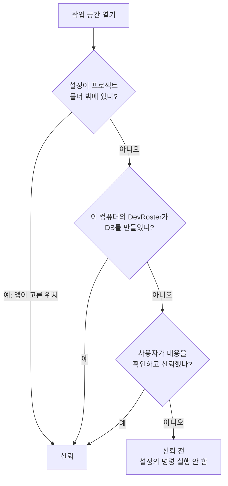
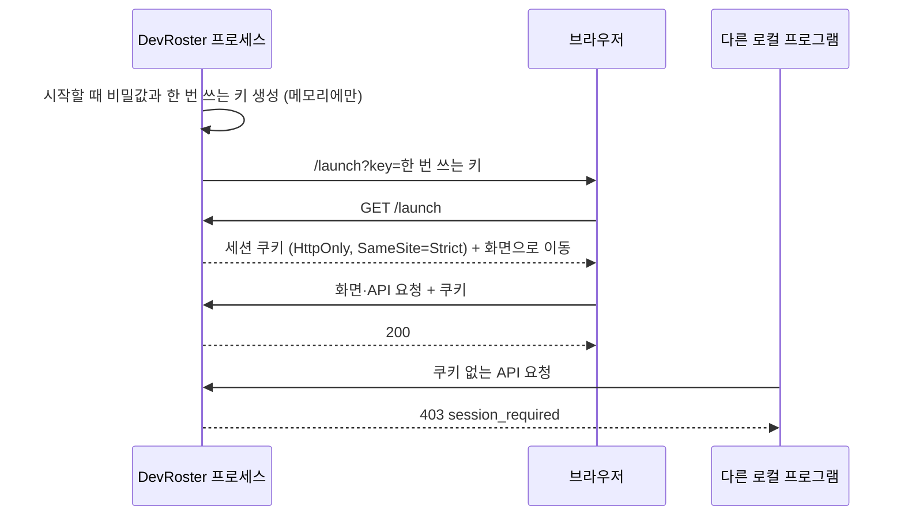

> DevRoster 개발기 시리즈입니다. 전체 목록은 [시리즈 목차](/posts/devroster-series/)에 있습니다.
{: .prompt-info }

"내 컴퓨터에서만 도는 앱인데 보안이 왜 필요하지?"라고 생각하기 쉽습니다. 하지만 DevRoster는 **남이 만든 저장소를 열고, 그 안의 코드를 AI가 읽고 고치고, 명령을 실행하는 앱**입니다. 공격자가 앱에 접속하지 않아도, 앱이 여는 파일을 통해 들어올 수 있습니다.

이 글의 내용은 공개 버전 0.4.8 기준이고, 여기서 다루는 문제는 모두 그 버전에서 고쳐졌습니다.

## 점검 방법

점검은 코드를 바꾸지 않는 읽기 전용으로 진행했고, 원칙을 먼저 정했습니다.

- 코드 경로를 끝까지 따라갔거나 **실제로 재현한 것만 "확인됨"**으로 적는다. 추측은 추측으로 표시한다.
- 재현은 임시 폴더와 임시 앱 홈에서만 한다. 실제 사용자 데이터와 실제 AI 호출은 쓰지 않는다.
- 이미 막혀 있는 공격은 **어디서 막히는지 한 줄로 기록**한다. 그 기록도 점검 결과다.

## 위협 모델

공격자를 여섯 종류로 나눴습니다.

| | 공격자 | 들어오는 길 |
|---|---|---|
| T1 | 악성 웹 페이지 | 사용자가 앱을 켠 채 방문한 외부 사이트 |
| T2 | 악성 저장소·기획서 | 사용자가 받아서 여는 프로젝트 내용 |
| T3 | 악성 백업 파일 | 복원하는 백업 |
| T4 | 외부 서비스 응답 | Slack, MCP 서버가 돌려주는 내용 |
| T5 | 같은 컴퓨터의 다른 프로세스 | loopback 포트에 접속할 수 있는 모든 것 |
| T6 | AI CLI 자체 | 프롬프트 주입으로 조종되는 AI |

## 이미 막혀 있던 것

먼저 좋은 소식입니다. 웹 페이지를 통한 공격(T1)과 백업 파일(T3)은 대부분 막혀 있었습니다.

- **DNS rebinding**: 모든 요청의 `Host` 헤더가 `127.0.0.1:<포트>` 또는 `localhost:<포트>`가 아니면 거부합니다.
- **CSRF**: 쓰기 요청은 화면별 토큰, 같은 출처(`Origin`, `Sec-Fetch-Site`), JSON 본문을 모두 요구합니다.
- **XSS**: CSP가 인라인 스크립트와 스타일을 막고, 화면은 텍스트를 `textContent`로만 넣습니다.
- **백업 복원(T3)**: 파일 이름·크기·해시를 검사하고, 링크와 하위 폴더를 거부하며, 복원된 작업 공간의 승인과 연결을 모두 무효로 돌립니다.
- **원격 MCP 서버로의 SSRF**: 이름을 해석한 IP를 고정하고, 공인 주소만 허용합니다.
- **명령 주입**: 셸 문자열을 쓰지 않고 항상 인자 배열로 실행합니다.

## 가장 심각했던 문제: 저장소와 함께 온 설정

DevRoster는 설정과 DB를 프로젝트 안의 `.agent-dev/` 폴더에 둘 수 있습니다. 프로젝트 폴더를 옮기거나 공유하기 편하라고 만든 배치입니다. 문제는 **이 폴더가 저장소에 커밋되어 다른 사람에게 갈 수 있다**는 점이었습니다(T2).

점검에서 재현한 시나리오는 이렇습니다. 공격자가 저장소에 프로젝트 훅(`.ai/hooks`)과 함께, 그 훅을 "이미 승인했다"는 승인 파일을 `.agent-dev/` 안에 넣어 둡니다. 피해자가 이 저장소를 받아 DevRoster로 열면, 앱은 그 승인 파일을 사용자의 승인으로 믿었습니다.

원인은 구조에 있었습니다. "이 폴더의 설정을 믿어도 되는가"를 판단하는 곳이 없었고, 작업 공간 위치를 판단하는 코드는 다섯 곳에 흩어져 있었습니다.

## 고친 방법 1: 신뢰를 코드로 정의하기

"신뢰"를 한 곳(`workspace_trust`)에서 판단하도록 만들었습니다. 설정이 프로젝트 폴더 안에 있는 작업 공간은 다음 중 하나일 때만 신뢰합니다.



신경 쓴 부분은 다음과 같습니다.

- **신뢰 기록은 앱 관리 폴더에만 둡니다.** 저장소는 자기 신뢰를 함께 실어 보낼 수 없습니다.
- **기록은 DB 파일의 경로와 파일 식별자(장치·inode)에 묶습니다.** 신뢰했던 폴더를 지우고 같은 경로에 다른 저장소를 받아도 신뢰가 넘어가지 않습니다. (이 식별자에는 구멍이 하나 있었고, 아래에서 따로 다룹니다.)
- **훅 승인도 앱 관리 폴더로 옮겼습니다.** 프로젝트 안의 승인 파일은 더 이상 읽지 않습니다.
- **업그레이드해도 기존 사용자는 변화가 없습니다.** 처음 실행할 때 이미 등록된 프로젝트를 신뢰 목록에 넣습니다. 이때 순서가 중요했습니다. 진입점이 폴더를 등록하기 **전에** 목록을 만들어야, 업그레이드 직후 새로 받은 저장소를 열어도 그 저장소가 "기존 프로젝트"로 섞여 들어가지 않습니다. 이 구멍은 구현 후 다시 검토하다가 찾았습니다.

신뢰 전에는 작업 승인·실행·검증, AI 생성, 로그인 확인, MCP 서버, 미리보기 서비스 실행을 모두 거부하고, 화면에는 실행될 명령 목록을 보여 주고 확인받습니다.

## 고친 방법 2: 자식 프로세스에 넘기는 환경변수

두 번째로 큰 문제는 환경변수였습니다(T6). AI가 작성한 코드를 검증하려고 테스트 명령을 실행할 때, 사용자 셸의 **환경변수 전체**가 그대로 넘어가고 있었습니다. 셸에는 클라우드 키나 토큰이 있을 수 있고, AI가 쓴 테스트 코드는 그 값을 읽을 수 있습니다.

프로세스 종류마다 환경변수 정책이 제각각이었던 것을 **표 하나**로 모았습니다.

```python
KINDS = {
    "hook":      {"keys": SYSTEM,                                  "timeout": 60},
    "mcp_stdio": {"keys": SYSTEM + NETWORK,                        "timeout": 30},
    "check":     {"keys": SYSTEM + NETWORK + TOOLCHAINS + ISOLATION, "timeout": 900},
    "preview":   {"keys": SYSTEM + NETWORK + TOOLCHAINS + ISOLATION, "timeout": None},
    "git":       {"keys": None,                                    "timeout": 300},
}
```
{: file="domain/exec_policy.py (요약)" }

검증 명령은 시스템 기본값, 툴체인(`JAVA_HOME`, `GOPATH` 등), 프록시·인증서 설정, 그리고 **프로젝트가 승인한 환경변수**만 받습니다. git은 사용자의 인증 도구가 필요해 전체 환경을 쓰되, 자격 증명 입력을 기다리며 멈추지 않도록 `GIT_TERMINAL_PROMPT=0`과 제한 시간을 둡니다.

이 변경 뒤 기존 테스트 하나가 실패했습니다. 셸 환경변수가 검증 명령에 그대로 넘어간다고 가정한 테스트였습니다. 버그가 아니라 **막으려던 동작을 테스트가 기대하고 있던 것**이라, 실제 사용 방식대로 그 키를 승인된 환경변수로 등록하도록 테스트를 고쳤습니다.

## 고친 방법 3: 화면과 API는 앱이 연 브라우저에만

세 번째는 같은 컴퓨터의 다른 프로세스였습니다(T5). 화면은 `127.0.0.1`에서만 열리지만, loopback 포트에는 같은 컴퓨터의 다른 프로그램과 다른 사용자도 접속할 수 있습니다. `Host`·`Origin` 검사는 **다른 웹 사이트**를 막을 뿐, 헤더를 직접 넣어 보내는 로컬 프로그램은 막지 못합니다. 그래서 세션 없이도 프로젝트 문서와 설정을 읽고 앱을 끌 수 있었습니다.

고친 방식은 "앱이 연 브라우저만 안다"는 비밀을 하나 두는 것입니다.



- 비밀값은 프로세스마다 새로 만들고 메모리에만 둡니다. 앱을 다시 켜면 예전 탭은 안내 화면을 받습니다.
- 쿠키는 한 번만 쓸 수 있는 실행 주소로만 발급합니다. 앱이 브라우저를 열 때는 본인만 읽을 수 있는 파일을 거쳐, 키가 프로세스 목록의 명령줄에 남지 않게 했습니다.
- 서버를 만드는 공통 클래스 한 곳에서 모든 handler를 감쌌습니다. 서버마다 따로 넣었다면 하나쯤 빠뜨렸을 겁니다.
- 세션 없이 응답하는 것은 데이터가 없는 정적 파일, 실행 중인 앱을 찾는 상태 확인, 자체 `state`로 보호되는 OAuth callback뿐입니다.
- 기존 `Host`·`Origin` 검사와 쓰기 토큰은 그대로 두었습니다. 방어를 바꾼 것이 아니라 한 겹 더한 것입니다.

기존 테스트 중 화면과 API를 HTTP로 부르는 것이 많아서, 테스트 쪽은 HTTP 클라이언트 수준에서 테스트 프로세스의 쿠키를 붙이도록 한 곳만 고쳤습니다. 세션 검사 자체는 쿠키를 붙이지 않는 별도 테스트가 확인합니다.

## 고친 방법 4: 남의 글이 명령이 되는 길

외부에서 들어온 내용(T2, T4)이 그대로 "실행"으로 이어지는 길이 두 군데 있었습니다.

**stdio MCP 서버.** MCP 서버 중에는 내 컴퓨터에서 프로그램으로 실행되는 종류가 있습니다. 연결을 등록할 때 `npx`·`curl`·`sh` 같은 실행기 이름을 막는 목록이 있었지만, 이름 목록은 `python3 -c "..."` 같은 명령을 막지 못합니다. 그래서 경계를 **사용자 확인**으로 옮겼습니다. 서버를 처음 시작하기 전에 실제로 실행될 파일 경로, 인수, 넘겨줄 환경변수 이름을 보여 주고 확인받습니다. 확인한 내용의 해시는 앱 관리 폴더에 남기고, 명령이나 인수가 바뀌거나 `PATH`에서 다른 파일이 잡히면 다시 확인합니다.

**Slack 봇 메시지.** DevRoster는 Slack에서 허용한 사용자의 명령을 받습니다. 그런데 허용한 봇이 PR 제목이나 이슈 본문 같은 **남이 쓴 글을 채널에 그대로 옮기면**, 그 글을 쓴 사람이 명령을 보낸 것과 같아집니다. 봇이 보낸 메시지에는 봇 전용 허용 명령만 적용하도록 바꿨고, 기본값은 상태 조회뿐입니다. 승인은 봇에 허용할 수 없습니다.

두 경우 모두 원칙은 같습니다. **목록으로 걸러내려 하지 말고, 누가 결정했는지를 확인한다.**

## 공개 CI가 찾아 준 구멍: inode 재사용

마지막은 직접 찾지 못한 문제입니다. 0.4.7을 공개한 뒤 GitHub Actions의 **Linux 실행에서만** 테스트 하나가 실패했습니다. "신뢰한 경로에 다른 DB를 두면 신뢰하지 않는다"는 테스트였습니다.

테스트가 불안정한 것이 아니라 실제 약점이었습니다. 신뢰 기록은 DB 파일을 경로와 `[장치, inode]`로 가리키는데, Linux 파일 시스템(ext4, XFS, overlayfs 등)은 **지운 파일의 inode 번호를 다음 새 파일에 다시 줍니다.** 신뢰된 경로의 DB를 지우고 다른 DB를 같은 경로에 두면 같은 파일로 판정될 수 있었습니다. macOS(APFS)와 Windows(NTFS)는 번호를 다시 주지 않아 개발 컴퓨터에서는 드러나지 않았습니다.

Linux에서는 `statx`로 읽은 **파일 생성 시각**을 식별자에 더해 `[장치, inode, 생성 시각]`으로 바꿨습니다. 기존 기록은 그 경로의 파일이 여전히 같은 파일일 때 한 번만 새 형식으로 옮기므로, 사용자가 다시 신뢰할 필요는 없습니다.

## 남은 한계

모든 것을 막았다고 쓰면 거짓말입니다. 생성 시각을 알려 주지 않는 일부 파일 시스템, 실행 확인이 경로와 인수까지만 보고 실행 파일의 내용 변경은 알아내지 못한다는 점처럼 알고 있는 한계는 저장소의 구조 문서에 적어 두었습니다. 한계를 숨기는 것보다 적어 두는 쪽이 다음 점검의 출발점이 됩니다.

## 배운 것

- **로컬 앱의 공격면은 네트워크가 아니라 "여는 파일"이다.** 저장소, 백업, 외부 서비스 응답이 모두 입력입니다.
- **보안 버그의 원인은 구조에 있다.** 판단하는 곳이 흩어져 있으면 한 곳을 막아도 다른 길이 열립니다. 신뢰 판단을 한 곳으로 모은 것이 패치 여러 개보다 효과가 컸습니다.
- **재현해야 확신할 수 있다.** 임시 폴더에서 공격을 끝까지 재현해 본 항목만 "확인됨"으로 적었고, 그 재현 시나리오가 그대로 회귀 테스트가 되었습니다.
- **지원하는 플랫폼 전부에서 테스트를 돌려야 한다.** inode 재사용은 개발 컴퓨터에서는 절대 드러나지 않는 문제였습니다. 실패한 테스트를 "불안정하다"고 넘기지 않은 것이 구멍을 막았습니다.

- 이전: [Claude·Codex·Gemini·K-EXAONE를 한 흐름으로](/posts/devroster-03-multi-ai/)
- 다음: [구글 EGM에서 한 걸음 더: 독립 검토와 드리프트 검사](/posts/devroster-05-independent-review/)
