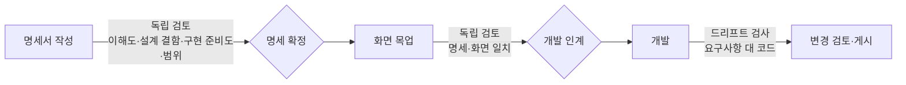

> DevRoster 개발기 시리즈입니다. 전체 목록은 [시리즈 목차](/posts/devroster-series/)에 있습니다.
{: .prompt-info }

## 계기: 구글의 "코끼리-금붕어 모델"

구글이 AI 코딩 에이전트용 플러그인 [Elephant-Goldfish Model(EGM)](https://github.com/google/elephant-goldfish-model)을 오픈소스로 공개했습니다(Apache 2.0). 아이디어는 이렇습니다.

- **코끼리**: 프로젝트 맥락을 기억하는 AI가 개발자와 함께 설계 명세서를 씁니다.
- **금붕어**: 대화 기록이 없는 AI가 명세서만 받아 검토합니다. 설계에 참여한 AI는 자기가 세운 잘못된 가정을 그대로 받아들이기 쉬우니, 맥락을 모르는 검토자를 따로 둡니다.
- **드리프트 리포트**: 구현된 코드가 명세와 어긋났는지 확인합니다.

DevRoster는 이미 명세 우선 흐름(기획서 → 명세서 확정 → 개발)을 갖고 있어서 방향이 잘 맞았습니다. 다만 그대로 따라 하기보다, DevRoster가 가진 것(여러 AI 도구, 승인 기록, 요구사항과 작업의 연결)으로 한 걸음 더 나가 보기로 했습니다. 이 글의 기능은 공개 버전 0.4.8에 들어 있습니다.

## EGM의 한계로 본 것

| EGM | DevRoster에서 바꾼 점 |
|---|---|
| 검토 결과가 문서로만 남음 | 지적마다 상태(열림·반영·위험 수용·반박)를 추적하고, 심각한 지적이 열려 있으면 다음 단계로 넘어가지 못함 |
| 보통 같은 모델이 검토 | 같은 관점을 **다른 계열의 모델**에 하나씩 맡기고, 함께 지적한 문제를 구분 |
| 드리프트는 주 1회 수동, 글로만 남음 | 작업마다 연결된 요구사항·수용 기준으로 검사하고, 명세에 없는 동작(반대 방향)도 찾음 |
| 효과 측정 없음 | (다음 단계) 사용자가 지적을 어떻게 처리했는지로 검토 AI별 적중률을 계산 |

## 어디에 배치할까

검토를 한 곳에 몰지 않고, 단계마다 볼 것을 나눴습니다.



- **명세 확정 직전**이 핵심입니다. 고치는 비용이 가장 쌉니다.
- 명세와 화면의 일치는 목업이 있어야 볼 수 있어서, **개발 인계**를 막는 지점으로 둡니다.
- 개발 중에는 이미 단계별 교차 검토가 있어 중복하지 않습니다.
- 개발 후에는 **드리프트 검사**로 명세와 코드의 차이를 봅니다.

## 1. 명세 독립 검토

### 금붕어는 구조상 자연스럽다

DevRoster의 AI 호출은 매번 대화 기록 없이 새로 시작합니다. 검토자에게는 명세서(요구사항, 화면, 확인 질문, 문서)만 넘기고, 명세서를 만든 대화는 넘기지 않습니다. 금붕어 조건이 따로 장치 없이 만족됩니다.

### 관점별로, 모델 계열별로

관점은 다섯 가지입니다.

| 관점 | 보는 것 |
|---|---|
| 이해도·자기완결성 | 기획서를 본 적 없는 사람이 추측 없이 설명할 수 있는가 |
| 설계 결함 | 요구사항 간 모순, 빠진 오류·예외 처리, 권한 공백 |
| 구현 준비도 | 수용 기준을 테스트할 수 있는가, 입출력·검증 규칙이 정해졌는가 |
| 범위·근거 | 기획서 원문에 없는 요구사항(범위 확장), 빠진 기획 내용 |
| 명세·화면 일치 | 요구사항 없는 화면 요소, 화면에 빠진 요구사항 |

같은 관점을 사용 중인 도구에서 **모델 계열마다 하나씩, 최대 3개**에 따로 맡깁니다. 예를 들어 Claude, Codex, K-EXAONE가 같은 명세를 각자 검토합니다. 결과를 합칠 때 같은 대상(요구사항·화면·문서)과 같은 관점에서 제목 단어가 많이 겹치는 지적은 하나로 묶고, 몇 개 계열이 함께 지적했는지 남깁니다.

```python
def _same(a, b):
    """같은 관점·같은 대상이고 제목 단어가 절반 이상 겹치면 같은 문제로 본다."""
    if (a["lens"], a["anchor_kind"], a["anchor_id"]) != (b["lens"], b["anchor_kind"], b["anchor_id"]):
        return False
    left, right = _words(a["title"]), _words(b["title"])
    return bool(left and right) and len(left & right) / min(len(left), len(right)) >= 0.5
```
{: file="domain/spec_review.py (요약)" }

서로 다른 회사의 모델이 독립적으로 같은 문제를 찾았다면, 한 모델만 지적한 것보다 실제 문제일 가능성이 높습니다. 화면에는 "2개 계열 함께 지적"처럼 표시합니다.

### 지적은 처리해야 넘어간다

지적마다 **반영함 / 위험 수용 / 반박**을 고릅니다. 수용과 반박에는 이유를 반드시 적어야 합니다. 심각한 지적이 열려 있으면 명세를 확정할 수 없고, 확정 기록에는 "알고도 받아들인 위험" 목록이 함께 남습니다. 나중에 문제가 생겼을 때 "그때 알고 있었는가"를 확인할 수 있습니다.

## 2. 드리프트 검사

개발이 끝난 작업에 대해, 그 작업에 연결된 **요구사항과 수용 기준**(예: `REQ-001:AC-02`)을 작업의 코드 변경과 비교합니다. DevRoster는 개발 인계 때 요구사항과 작업을 연결해 두기 때문에, 비교할 명세 범위가 정확히 정해집니다.

검토자는 개발에 쓰인 도구와 **다른 계열**을 우선 고르고, 찾는 범주는 여섯 가지입니다.

- 명세에 있는데 코드에 없음
- 데이터 구조의 필드·상태 누락
- 동적 처리 대신 하드코딩·임시 처리
- 명세와 다른 구조·라이브러리
- 수용 기준 미충족
- **명세에 없는 동작** (반대 방향 드리프트)

마지막 범주가 중요합니다. AI는 시키지 않은 기능을 "친절하게" 추가하곤 합니다. 이런 코드는 명세에 없으니 아무도 검토하지 않고 테스트도 없습니다. 반대 방향 드리프트로 찾은 항목은 요구사항 변경 제안으로 연결해, 명세에 넣을지 코드에서 뺄지 사람이 결정합니다.

## 구현하며 지킨 원칙

- **정본 스키마를 바꾸지 않는다.** 드리프트 결과는 작업 이벤트로만 남겨 기록이 덧붙기만 합니다.
- **실패해도 비용은 남긴다.** 검토자 한 명이 실패해도 나머지 결과는 저장하고, 실패한 호출의 토큰도 사용량에 기록합니다.
- **제공자 출력은 화면에 그대로 보이지 않는다.** 실패 이유는 정해진 문구로만 보여 줍니다.

## 다음 단계

**드리프트 검사를 검증에 붙이기.** 지금은 검토 화면에서 사람이 눌러야 검사가 실행되고, 결과가 게시를 막지 않습니다. 검증이 통과하면 자동으로 검사하고, 처리하지 않은 심각 지적이 있으면 게시를 막을지를 프로젝트가 고르는 설정을 다음 버전에 넣을 예정입니다. 기본값은 지금과 같게 둡니다. 검사마다 AI를 한 번 호출하므로, 비용을 쓸지는 사용자가 정해야 합니다.

**검토자 성적표.** EGM에 없는 가장 큰 차별점으로 노리는 것입니다. 지적마다 사용자가 남긴 결정(반영·위험 수용은 맞은 지적, 반박은 틀린 지적)이 이미 DB에 있으니, 이것으로 검토 AI별·관점별 적중률을 계산할 수 있습니다. 처리한 지적이 충분히 쌓인 AI를 우선 쓰고, 이유를 적어 반박한 지적은 다음 검토에 전달해 같은 지적이 되풀이되지 않게 하는, 쓸수록 좋아지는 검토입니다. 지금 개발 중이고, 다음 버전 이후에 따로 다루겠습니다.

- 이전: [로컬 앱도 공격받는다: 보안 점검과 신뢰 경계](/posts/devroster-04-security/)
- 다음: [AI 토큰과 비용을 숫자로 보기: 사용량 대시보드](/posts/devroster-06-usage-dashboard/)
