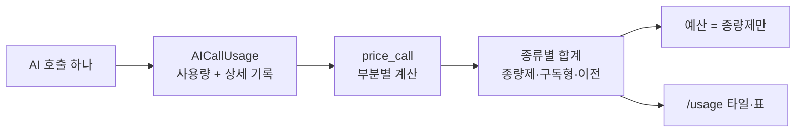

> DevRoster 개발기 시리즈입니다. 전체 목록은 [시리즈 목차](/posts/devroster-series/)에 있습니다.
{: .prompt-info }

6편에서 대시보드를 만들며 집계 버그 세 개를 고쳤다. 그런데 며칠 쓰고 나니 남은 문제는 산수가 아니었다. 무엇을 비용으로 셀 것인가가 정해져 있지 않았다. 더하기는 맞는데 더할 대상이 틀린 상태였다.

그 기준을 세우고, 실제 AI를 돌려 검증하는 과정에서 계산 오차를 하나 찾아 고쳤다. 0.5.0을 공개한 뒤에 이어진 작업이라 공개된 0.5.0에는 들어 있지 않다.

## 구독으로 쓰는데 예산이 멈춘다

DevRoster는 작업을 승인할 때 예상 비용 한도를 정하고, 쓴 만큼이 한도에 가까워지면 알리고 넘으면 멈춘다. 그런데 Claude Code나 Codex CLI를 구독으로 로그인해서 쓰는 경우에도 자동 가격표의 API 단가로 환산한 금액을 예산에 그대로 넣고 있었다.

월 20달러 구독을 쓰는 사람에게 "이번 달에 21달러어치 쓰셨습니다"라며 작업을 멈추는 건 말이 안 된다. 그렇다고 그 금액을 0원으로 보여 주는 것도 거짓이다. 실제 청구액은 구독이라 알 수 없지만, 모델이 처리한 양은 알 수 있으니까.

그래서 도구마다 구독형인지 종량제인지를 설정에서 고르고, 계산을 두 갈래로 나눴다.

| 지불 방식 | 예산에 들어가는가 | 화면에서 부르는 이름 |
|---|---|---|
| 종량제 (API, 또는 종량제로 지정한 CLI) | 들어간다 | 종량제 예상 비용 |
| 구독형 (구독 로그인 CLI) | 들어가지 않는다 | 구독형 환산, 실제 청구 아님 |

코드에서는 이걸 계산 기준 2라고 부른다. 새로 승인하는 작업의 스냅샷에 `cost_basis: 2`가 들어가고, 그 값이 없는 예전 작업은 기준 1(지금까지의 계산)로 읽는다. 이미 승인한 작업의 숫자가 설정 변경으로 바뀌면 안 되기 때문이다. 예산 계산처럼 돈이 걸린 값은 특히 그렇다.

기본값은 직접 고르지 않았을 때 API는 종량제, CLI는 구독형이다. 예외가 하나 있다. 손으로 입력한 가격표에 그 CLI의 단가가 있으면 종량제로 본다. 그동안 예산에 들어가던 동작을 말없이 바꾸지 않으려는 것이다. 기존 사용자 입장에서는 갑자기 예산이 안 멈추는 것처럼 보일 수 있다.

## 캐시를 한 덩어리로 세고 있었다

6편에서 Claude의 캐시 토큰이 버려지던 버그는 고쳤다. 하지만 그때도 캐시 읽기와 캐시 생성을 각각 캐시 단가, 입력 단가로 뭉뚱그렸다. 실제 청구는 더 나뉜다.

캐시 읽기는 캐시 단가다. 캐시 생성은 입력보다 비싸다. Anthropic은 기본 5분 캐시를 입력 단가의 1.25배, 1시간 캐시를 2배로 받는다. 한 호출에 5분과 1시간이 섞일 수도 있다. 그러니 토큰을 네 가지로 나눠 기록해야 한다.

| 필드 | 뜻 |
|---|---|
| `input` | 캐시에서 읽지도, 캐시에 쓰지도 않은 새 입력 |
| `cache_read` | 캐시에서 읽은 토큰 |
| `cache_write` | 캐시에 쓴 토큰 (`cache_write_5m`, `cache_write_1h`로 수명 구분) |
| `output` | 추론 토큰 포함 |

`reported_input`은 제공자가 보고한 입력 합계를 따로 남긴다. 캐시 수가 빠졌거나 서로 맞지 않으면 `input`을 `None`으로 두고 이 값만 남긴다. 모르는 값은 0이 아니라 `None`이다. 0으로 채우면 그럴듯하지만 틀린 금액이 나온다.

기록은 호출마다, 그 안에서 모델마다 남긴다. 카운터가 서로 겹치지 않게 정리한 뒤에 저장한다.

```text
{"schema": 2, "calls": [
  {"provider": "claude_cli", "scope": "model_usage", "resumed": false, "session": "...",
   "parts": [{"model": "claude-sonnet-4-5", "observed": true,
              "input": 40, "output": 700, "cache_read": 90000, "cache_write": 5000,
              "reported_input": 40, "cache_write_5m": 0, "cache_write_1h": 5000}],
   "cache_write_ttl": {"5m": 0, "1h": 5000, "scope": "usage"}}]}
```
{: file="domain/usage_record.py (형식 요약)" }

`scope`는 카운터를 어디서 읽었는지 적는다(`model_usage`, `usage`, `response`, `turns`, `stats`). Claude의 `usage`와 `modelUsage`는 재개 세션에서 서로 다른 것을 셀 수 있어서, 범위가 다른 합계를 말없이 더하지 않으려고 붙였다.

## 캐시 수명을 모르면 표시하고 계산한다

캐시 쓰기 비용은 단가표에 두 칸을 새로 받는다. `cache_write_per_million`(기본, 보통 5분)과 `cache_write_1h_per_million`(1시간)이다.

```python
def _write_cost(part, call, price, flags):
    """Cost of the part's cache writes per million-token rates, or None when it cannot be known."""
    written = part["cache_write"] or 0
    if not written:
        return 0.0
    base, hourly, fallback = price.get("cache_write_per_million"), price.get("cache_write_1h_per_million"), price["input_per_million"]
    five, hour = part.get("cache_write_5m"), part.get("cache_write_1h")
    ttl = call.get("cache_write_ttl")
    if five is None and len(call["parts"]) == 1 and isinstance(ttl, dict) and ttl.get("5m", 0) + ttl.get("1h", 0) == written:
        five, hour = ttl["5m"], ttl["1h"]
    if five is None or hour is None:
        flags.append("cache_write_ttl_assumed")  # D-15 6: unknown lifetime priced as the base write.
        five, hour = written, 0
    if (five and base is None) or (hour and hourly is None):
        flags.append("cache_write_rate_fallback")
    rate5 = base if base is not None else fallback
    rate1 = hourly if hourly is not None else fallback
    return five * rate5 + hour * rate1
```
{: file="domain/usage_policy.py (요약)" }

수명을 모르면 전부 기본(5분) 단가로 계산하고 `cache_write_ttl_assumed`를 붙인다. 1시간 단가가 없으면 입력 단가로 대신 계산하고 `cache_write_rate_fallback`을 붙인다. 추정했다는 사실을 숨기지 않는 쪽을 골랐다. 화면에는 이 표시가 붙은 계산이 몇 건인지 횟수로 나온다.

한 부분이라도 계산할 수 없으면 그 호출의 비용은 `None`이고, 계산된 부분합은 `known_subtotal`로 따로 돌려준다. 절반만 아는 호출을 완전한 금액처럼 보여 주지 않으려는 것이다.

## 금액이 맞지 않았다: 0.084와 0.056

여기까지는 코드 리뷰로 정리한 설계다. 진짜 시험은 실제 AI를 돌려 보는 것이었다. 작은 연습용 폴더에서 Claude CLI를 앱의 격리 설정 그대로 실행하고, Claude가 결과에 적어 준 금액과 내 계산을 비교했다.

| 호출 | Claude가 보고한 금액 | 고치기 전 계산 | 고친 뒤 계산 |
|---|---|---|---|
| 긴 고정 문맥 + 짧은 답 | 0.08384 | 0.056028 | 0.08384 |
| 같은 문맥, 새 대화 | 0.083844 | 0.056032 | 0.083844 |
| 1번 대화 이어 받기 | 0.0053523 | 0.005352 | 0.005352 |

첫 줄이 33% 낮게 나왔다. 원인은 상상하지 못한 곳에 있었다. Claude CLI는 본 모델 호출과 함께 작은 보조 모델(haiku) 호출도 `modelUsage`에 함께 보고한다. 모델 항목이 둘 이상이면 캐시 생성 수명 구분을 어느 모델에 붙여야 할지 확신할 수 없어서, 호출 단위 값으로만 남겨 두고 있었다. 계산할 때 그 구분을 못 쓰니 1시간 캐시를 5분 단가로 계산한 것이다. 보조 모델 하나가 섞였다는 이유로 같은 호출의 금액이 33% 낮게 계산되고 있었다.

고친 방법은 최상위 `usage`와 숫자가 정확히 같은 모델 하나에만 수명 구분을 붙이는 것이다.

```python
def main(row):  # The model the top-level usage reports.
    counts = [record.count(row.get(key)) for key in ("inputTokens", "outputTokens", "cacheReadInputTokens")]
    written = record.count(row.get("cacheCreationInputTokens"))
    return written is not None and five is not None and hour is not None and five + hour == written and (
        len(rows) == 1 or (None not in top and counts == top)
    )

matches = [index for index, (_name, row) in enumerate(rows) if main(row)]
target = matches[0] if len(matches) == 1 else None
```
{: file="runners/usage.py (요약)" }

조건을 만족하는 모델이 둘 이상이면 추측하지 않고 지금처럼 호출 단위에 남긴다. 수명을 잘못 붙여 계산하는 것보다 모른다고 표시하는 편이 낫다.

실측에서 두 가지를 더 알았다.

재개 세션 표시는 필요 없었다. 이전 대화를 이어 받은 호출도 그 호출분만 보고했다. 계산이 0.005352 대 0.0053523으로 맞았다. "앞선 호출이 합계에 들어 있을 수 있음"이라고 겁을 주던 표시를 지웠다. 숫자는 그대로고 안내만 줄었다.

같은 문맥이라도 새 대화에서는 캐시를 다시 쓴다. 메시지 끝이 달라 캐시 범위가 맞지 않기 때문이다. 캐시에서 16,661토큰을 읽은 것은 이어 받은 대화였다. "같은 프롬프트니 캐시가 맞겠지"는 틀린 가정이었다.

## Codex는 표준입력을 기다리고 있었다

실측 중에 `codex exec`가 5분 동안 아무 응답이 없었다. 모델이 느린 게 아니라, `codex exec`가 표준입력이 터미널이 아니면 입력이 끝날 때까지 추가 입력을 더 읽는 동작이었다. 사람이 터미널에서 쓰면 문제가 없지만, 앱이 터미널 없이 실행하면 같은 일이 생긴다.

프롬프트를 인자로 줄 때는 표준입력을 닫도록 바꿨다.

```python
# Codex reads extra input from a stdin that is not a terminal until it ends; an app
# without a terminal would wait for input that never comes.
stdin=subprocess.PIPE if self.stdin_prompt else subprocess.DEVNULL,
```
{: file="runners/codex_cli.py (요약)" }

타임아웃 로그를 보지 않았으면 "Codex가 느리다"로 결론 냈을 문제다. 5분을 기다리는 동안 의심할 곳은 모델 성능인데, 실제로는 파이프 하나가 열려 있었다.

## 실패한 호출도 돈이다

가장 큰 구멍은 이거였다. 사용량 기록은 성공한 호출의 결과에서만 뽑았다. 실패한 호출, 재시도, 교차 검증, 형식 수리, 드리프트 검사는 비용에 들어가지 않았다. 실제로 쓴 만큼이 아니었다.

그래서 호출 하나마다 기록 하나(`AICallUsage`)를 남긴다.

기록 시점은 CLI면 프로세스가 실제로 시작된 뒤, API면 요청을 실제로 보낸 뒤다. 인증·정책·요청 크기 같은 사전 검사에서 멈춘 것은 호출이 아니므로 기록하지 않는다.

실패 경로는 응답이 잘렸거나 HTTP 오류, 0이 아닌 종료 코드, 시간 초과, 중단이다. 보고된 값이 없으면 빈 사용량으로 남기고 값을 추정하지 않는다.

용도(`purpose`)는 `phase`, `repair`, `session`, `fallback`, `cross_check`, `drift`, `studio`로 나눈다. 재시도와 다른 실행기로 바꾼 호출도 각각 하나로 남는다.

### 강제로 멈춰도 보고된 사용량은 남긴다

Ctrl+C로 실행을 끊어도 그 전에 모델이 사용량을 보고했을 수 있다. 프로세스를 정리하면서 그때까지 출력된 것을 읽어 기록한다.

```python
except KeyboardInterrupt:
    process.terminate()
    rest = ""
    try:
        rest = process.communicate(timeout=5)[0] or ""
    except subprocess.TimeoutExpired:
        process.kill()
        rest = process.communicate()[0] or ""
    self._keep_usage(rest)  # An interrupted run may already have reported usage.
    raise
```
{: file="runners/claude_cli.py (요약)" }

시간 초과로 죽인 실행도 마찬가지다. "끊었으니 안 쓴 셈"이 아니라 "끊었지만 그때까지 썼다"가 맞다.

### 예산은 어디서 멈추나

여기서 판단이 하나 필요했다. 실패한 호출까지 비용에 넣으면 재시도할 때마다 예산이 줄어든다. 그렇다고 재시도 직전에 멈추면, 이미 결제한 작업을 재개할 때 다시 결제해야 한다.

그래서 새로 시작하는 호출을 다시 부르기 직전에만 예산을 확인한다.

```python
# Requests that start work afresh. Only a call made again after a failed call of one of these
# (a retry, another runner, a restarted session) waits for the budget pause: the failed call
# left nothing to keep. A first call is checked by the coordinators before the attempt, and
# repairs and cross-checks are never stopped halfway: the resume would pay again for the work
# they continue (as would a fallback right after a session, which is a first call).
FRESH = {"phase", "session", "fallback"}
```
{: file="adapters/ai_calls.py (요약)" }

수리와 교차 검증, 세션 직후의 단계별 실행은 도중에 멈추지 않는다. 첫 호출은 지금처럼 각 실행기가 시도 전에 확인한다.

부작용으로 문제 해결 표에 새 항목이 생겼다. "예산 도달 시 멈추기를 켰는데 조금 넘김"이다. 다음 단계 전과 실패한 호출을 다시 부르기 직전에만 멈추므로 한 단계만큼은 넘을 수 있다. 넘지 않게 하려면 문 중간에 멈추는 수밖에 없고, 그러면 재개할 때 같은 작업을 두 번 결제한다. 그래서 조금 넘을 수 있는 쪽을 택했다.

### 기록을 못 남겼을 때

호출 기록 저장이 실패해도 AI 호출 결과를 바꾸거나 다시 호출하지 않는다. 대신 같은 `call_id`로 세 번 저장을 시도하고, 그래도 실패하면 그 시도의 `RunnerUsage`에 `unsaved_calls`로 실어 저장한다. 읽는 쪽은 이걸 호출 기록과 똑같이 읽고, 재시도 직전 정지 판정에도 아직 저장하지 못한 기록을 넣는다.

한계도 적어 둔다. DB가 세 번 실패하고 `RunnerUsage` 저장까지 실패하면 그 호출은 남지 않는다. 그리고 읽을 기록을 고르는 일은 시도(attempt) 단위로 한 번에 정한다(`usage_events.select`). 같은 시도 안에서 어떤 호출은 호출 기록에서, 어떤 호출은 `RunnerUsage`에서 읽으면 한 호출을 두 번 세게 된다.

## 화면

흐름을 한 장으로 그리면 이렇다.



사용량 화면 맨 위 요약 칸을 셋으로 나눴다. 종량제 예상 비용, 구독형 환산, 이전 계산 기준이다. 표와 일별 칸은 종량제를 대표 금액으로 보여 주고 다른 종류는 아래 줄에 적는다. 구독형 환산이 섞인 합계를 지출처럼 보여 주지 않기 위해서다.

작업 비용이 예전보다 크게 나올 수 있다. 실패·재시도·교차 검증·수리 호출이 이제 들어가기 때문이다. 그게 실제로 쓴 만큼이다. 예전 기록의 숫자는 바뀌지 않는다.

## 정리

무엇을 비용으로 셀 것인가가 얼마인가보다 먼저다. 계산이 아무리 정확해도 구독 사용료를 종량제 예산에 넣으면 틀린 답이다.

모르는 값을 0으로 채우지 않는다. 0은 그럴듯하고, 그럴듯한 0은 발견되지 않는다. `None`과 "추정함" 표시는 눈에 거슬리지만 고칠 수 있다.

실측은 문서보다 많이 알려준다. 보조 모델이 섞인 응답 모양도, Codex가 표준입력을 기다리는 동작도 코드 리뷰로는 나오지 않았다. 0.084와 0.056의 차이는 실제로 돌려 봐야 보였다. 제일 오래 걸린 부분도 계산이 아니라 실행이었다.

관측이 실행을 바꾸면 안 된다. 사용량 기록 저장이 실패해도 호출 결과를 바꾸지 않고 다시 호출하지도 않는다. 관측은 관측이고, 실패는 실패로 남긴다.

- 이전: [AI 토큰과 비용을 숫자로 보기: 사용량 대시보드](/posts/devroster-06-usage-dashboard/)
- 다음: [SI 납품 산출물 파이프라인과 브라우저 콘솔 오류](/posts/devroster-08-deliverables-and-console/)
