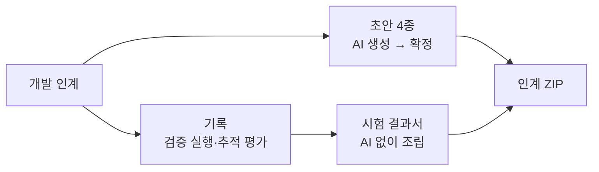

> DevRoster 개발기 시리즈입니다. 전체 목록은 [시리즈 목차](/posts/devroster-series/)에 있습니다.
{: .prompt-info }

SI 프로젝트에 결과물을 납품하려면 코드만으로는 부족하다. 시험 결과서, 데이터전환 설계서, 총괄시험계획서, 사용자·운영자 지침서가 필요하다. 대개는 개발자가 마감 전날 밤에 문서를 쓰고, 그 문서는 실제 기록과 조금씩 어긋난다. 어긋나는 이유는 게으름이 아니라, 기록을 다시 읽을 시간이 없기 때문이다.

이번에 한 일은 그 문서를 기록에서 자동으로 조립하고 AI로 초안을 만들게 하는 것(T-13, T-17)과, 화면 미리보기가 브라우저 콘솔 오류를 모아 오게 하는 것(T-18)이다. 0.5.0 공개 뒤에 이어진 작업이라 공개된 0.5.0에는 없다.

## 결과서가 기록보다 많이 말하면 안 된다

시험 결과서를 자동으로 만들면 위험이 하나 생긴다. 기록에 없는 통과를 만들어내는 것이다. 그리고 그런 구멍이 실제로 있었다.

검증 명령은 저장소가 그 단계에서 바뀌지 않았으면 실행하지 않고 건너뛴다. 시간을 아끼려는 정상 동작이다. 그런데 그 건너뜀도 "통과"로 저장되고 있었다. 그래서 결과서에는 실행조차 하지 않은 검증이 통과로 찍혔다. 문서를 만드는 사람이 일부러 거짓말하지 않아도 결과서가 거짓이 되는 구조였다.

그래서 결과서를 만들기 전에 판정 규칙부터 순수 함수로 고정했다.

| 판정 | 뜻 |
|---|---|
| 실행·통과 | 돌았고 통과했다 |
| 실행·실패 | 돌았고 실패했다 |
| 변경이 없어 실행하지 않음 | 범위 밖이라 건너뛰었다 (`skipped_scope`) |
| 필수 검증 결과 없음 | 필수로 지정한 검증의 결과가 기록에 없다 |
| 실행 기록 없음 | 아예 돌린 적이 없다 |
| 판정할 수 없음 | 기록이 모자라 판단할 수 없다 |

몇 가지를 같이 정했다. 훅과 내부 검사는 시험과 따로 센다. `source_unchanged`, `commit_unchanged`는 실행을 지키는 장치이지 시험이 아니다. 추적 연결은 결과서를 만들 때 다시 평가하고 `verified`일 때만 입증으로 본다. `mapped`(연결만 됨), `stale`(근거가 지금 코드와 다름), `missing`, `historical`, `retired`는 각각 따로 표시한다. 연결이 있다는 것과 확인됐다는 것은 다르다. 코드·화면 검토는 "검토 결정 이력"으로만 싣는다. 검토 승인은 인수시험이 아니다.

건너뜀은 문구가 아니라 상태로 저장한다. 근거 JSON에 `status: "skipped_scope"`를 함께 남긴다. 문구로 판정하면 문구를 고칠 때 과거 기록의 판정이 같이 바뀐다.

시험 단계(`level`)도 검증 명령마다 고를 수 있게 했다. 단위·통합·시스템·검사(빌드·lint)다. 비워 두면 설정에도 프로필에도 쓰지 않아서 기존 설정이 그대로이고, 보고서는 승인 시점 스냅샷의 단계를 쓴다. 나중에 단계를 정해도 이전 작업에는 소급되지 않는다.

## 기록에서 조립한다, AI는 쓰지 않는다

첫 결과서는 AI를 쓰지 않는다. 작업 공간 DB의 기록만으로 조립한다. 문서를 쓰는 AI가 문서에 유리하게 기억을 고치는 일을 막으려는 게 아니라, 애초에 기억할 게 없게 만든 것이다.

DB를 읽기 전용으로 열고, 등록된 비밀값을 지운 결과를 돌려준다. 결과서를 만드는 일이 기록을 바꾸면 안 된다. 수용 기준은 인계 하나의 요구사항과 연결을 추적 화면과 같은 방식으로 다시 평가하는데, 페이지를 나누지 않고 한 번에 읽어서 집계가 일부만 세는 일이 없게 했다. 작업별 검증은 승인 스냅샷에 있는 명령·시험 단계와 마지막으로 저장된 검증 실행의 판정을 쓴다. 스냅샷이 없는 작업은 명령을 지어내지 않고 "확정할 수 없음"으로 적는다.

그리고 한계 목록을 항상 넣는다. 결과서 뒤에 다섯 줄이 고정으로 붙는다.

```text
- 인수시험 기록(절차·입력·기대 결과·실제 결과)은 DevRoster에 없습니다. 코드·화면 검토 결정은
  검토 결정 이력으로만 싣고 인수시험 통과로 보지 않습니다.
- 수용 기준별 실행 입증은 지금 pytest 시험 대상에만 자동으로 남습니다. 다른 도구의 검증
  명령은 명령 단위 결과만 있습니다.
- 검증 명령의 실행 시간(소요 시간)은 기록되지 않습니다.
- 검토 결정의 작성자는 기록된 값이며 인증된 서명이 아닙니다.
- 작업에 마지막으로 저장된 검증 실행을 싣습니다. 그 실행이 지금 세대의 결과인지는 기록으로
  단정할 수 없습니다.
```
{: file="adapters/delivery_report.py (LIMITS)" }

자동화된 문서의 신뢰는 무엇을 넣었나보다 무엇을 넣지 못했는지 밝혔나에서 갈린다. 다섯 줄이 결과서 끝에 붙어 있으면 읽는 사람이 어디까지 믿을지 스스로 정할 수 있다.

출력은 Markdown과 혼자 열리는 HTML 두 가지다. 모든 값을 글자로만 내보내고 문법 문자와 HTML 문자를 escape한다. 요구사항 원문에 `|`가 들어 있어도 표가 깨지지 않고, `<script>`가 들어 있어도 스크립트가 되지 않는다.

## 초안 4종은 명세 밖에 둔다

납품 문서 네 종은 AI가 초안을 쓰고, 사용자가 고치고, 확정한다. 각 초안에 보내는 명세 문서를 허용 목록으로 고정했다.

| 초안 | 명세 문서 | 개발 기록에서 더하는 사실 |
|---|---|---|
| 데이터전환및초기데이터설계서 | 엔티티관계모형기술서, 데이터베이스설계서, 코드공통코드정의서, 인터페이스설계서 | 저장소 id |
| 총괄시험계획서 | 시험시나리오, 비기능요구사항정의서, 요구사항추적표 | 검증 명령(이름·저장소·시험 단계·필수) |
| 사용자지침서 | 사용자인터페이스설계서, 유스케이스명세서, 권한정의서 | 화면(id·제목·목적), 완료 작업 제목 |
| 운영자지침서 | 아키텍처설계서, 비기능요구사항정의서, 권한정의서 | 저장소 id, 환경변수 **키 이름**(값은 읽지 않음) |

여기서 가장 중요한 결정은 초안을 Studio 명세 안에 넣지 않은 것이다. 처음에는 자연스럽게 명세 옆에 두려고 했는데, 그러면 두 가지가 깨진다.

인계 근거 해시에 `project_version`이 들어 있다. 초안을 고칠 때마다 버전이 오르면 추적 근거가 전부 "오래됨"이 된다. 납품 직전에 초안 문장 하나 고쳤다고 수용 기준 입증이 날아가면 안 된다.

Studio `jobs` 표에 행이 살아 있으면 인계 읽기가 막힌다. 문서 초안 생성이 개발 인계 조회를 막는 것도 이상하다.

그래서 `deliverable_documents`, `deliverable_jobs` 표를 따로 두고 잠금 이름도 `deliverable:<id>`로 나눴다. 표는 `CREATE TABLE IF NOT EXISTS`로만 추가하고 Studio DB의 `user_version`(1)은 건드리지 않는다. 그래야 이전 앱도 같은 DB를 열 수 있다. 기능을 하나 더하자고 DB 버전을 올리면, 같은 폴더를 예전 버전으로 열었을 때 앱이 아예 안 뜬다.

### 보내기 전에 보여 준다

명세의 자유 문장은 이미 AI가 쓴 내용이라 그대로 전송된다. 그래서 생성 전에 보낼 내용 전체를 화면에 보여 주고 확인받는다. AI 도구·모델·추론 강도, 보낼 글자 수, 예상 시간도 함께 보여 준다. 미리 본 값의 해시(`preview_key`)가 지금 값과 다르면 409로 거절하고 AI를 부르지 않는다. 사용자가 본 것과 다른 내용을 보내지 않겠다는 것이다.

모델이 바꿀 수 없는 부분도 있다. 총괄시험계획서의 "검증 명령과 시험 단계" 표는 코드가 쓴다. 시험 단계는 기록에서 온 값이라 모델이 자기 판단으로 고치면 안 된다. 프롬프트에는 없는 사실을 지어내지 말고 "확인 필요"로 남기라고 지시한다. 다만 그건 지시일 뿐 보장이 아니라는 점을 문서에 그대로 적었다. 프롬프트를 보장이라고 쓰는 순간 그 문장이 다음 버그의 씨앗이 된다.

## /deliverables와 인계 ZIP



화면 하나(`/deliverables`)에서 인계를 고르고, 초안 네 종을 만들고 고치고 확정하고, ZIP으로 내려받는다. ZIP에는 인계 명세(인계 해시로 찾은 버전)의 문서, 고른 초안, 시험 결과서, `index.md`, `manifest.json`이 들어가고 인쇄용 HTML은 선택이다.

ZIP을 만들면서 정한 것들이다. 확정하지 않은 초안은 Markdown·HTML·목록 모두에 "초안"으로 표시하고 확인 필요 항목도 함께 넣는다. 원본 해시(저장된 버전)와 파일 바이트의 SHA-256을 따로 적는다. 둘은 같은 값이 아니다. 기준 정보로 인계 ID, 명세 버전과 해시, 목업·인계 묶음 해시, 인계 때 고정된 프로필, DevRoster 버전, 출처별로 읽은 시각을 적는다. 그리고 "묶음 전체가 한 시점의 기록"이라고는 쓰지 않는다. 파일마다 읽은 시각이 다르기 때문이다.

모든 값은 렌더링 전에 데이터 단계에서 가린다. 파일 이름에는 기록 값을 넣지 않는다. 조회는 `studio_store.open_read_only`로 연다. 읽기만 하는 화면이 Studio DB 파일을 만들거나 스키마를 적용하면 안 된다.

## 목업 의견: 수정 요청과 참고

화면 검토 의견이 전부 확정을 막으면, "이건 참고만 하면 됨"이라고 적으려던 메모도 처리해야 넘어간다. 그러면 참고 메모를 아예 안 쓰게 된다. 그래서 의견을 둘로 나눴다. 수정 요청(기본)은 처리해야 화면 확정, 최종 인계 묶음, 개발 인계가 된다. 참고는 막지 않고 인계 문서에 참고 사항으로 들어간다.

저장은 새 표 `comment_kinds`에 참고만 적는다. 줄이 없으면 수정 요청이다. 그래서 이미 남긴 의견은 손대지 않아도 전부 수정 요청이 되고, Studio DB 버전도 그대로다. 이전 앱이 이 DB를 열면 모든 의견을 수정 요청으로 본다. 기본값을 "더 엄격한 쪽"으로 둔 것이다.

여러 의견을 한 번에 처리하는 기능도 넣었다. 1~200개를 중복 제거해 받고, 한 트랜잭션에서 프로젝트 버전·진행 중인 생성 작업·현재 목업 버전·같은 버전의 의견인지·편집 가능한지를 모두 확인한다. 하나라도 맞지 않으면 아무것도 바꾸지 않는다. 수정 요청이 섞여 있으면 처리 메모가 필수이고, 참고만 골랐으면 선택이다.

인계 문서에 참고를 넣을 때는 JSON 한 덩어리로 넣는다. 줄바꿈은 JSON 문자열 안에서 인코딩하고 백틱과 `<`는 escape한다. 참고 문장이 문서 구조를 깨거나 지시처럼 보이지 않게 하려는 것이다. 등록된 비밀값은 인코딩 전에 가린다.

이 작업 중에 기존 버그도 하나 나왔다. "이전 목업 이어서 쓰기"가 의견을 새 버전으로 넘기지 않아서, 미해결 수정 요청이 있는데도 화면을 확정할 수 있었다. 기능을 검사하다가 옆의 구멍을 찾은 경우다.

## 브라우저 콘솔 오류를 모은다

변경 검토 화면에는 "실제 화면 미리보기"가 있다. 미리보기 서비스가 화면을 띄워 캡처하는데, 그 브라우저가 남긴 콘솔 오류를 모아 보여 주도록 했다. 표시만 하고 검토 결정은 막지 않는다. 검증 관문으로 쓸지는 표시가 쓸모 있는지 본 뒤에 정하려고 한다.

### 무엇을 모으나

`console.error`와 처리되지 않은 예외를 모은다. 예외는 메시지만 넣고 스택은 넣지 않는다. 경고는 모으지 않는다. 경고까지 모으면 목록이 쓸모없어진다.

페이지를 연 뒤 1초까지 모은다. 시작 요청과 타이머에서 늦게 나는 오류를 잡으려는 것이고, 캡처가 1초 늘어난다. worker가 차단한 외부 요청 때문에 브라우저가 찍는 리소스 오류는 뺀다. 차단한 주소와 정확히 같을 때만 뺀다.

worker는 메시지를 자르지 않는다. 4천 자가 넘으면 내용을 통째로 보내지 않는다. 자르면 비밀값이 조각나 가리기가 안 될 수 있어서, 자르는 일은 가리기 뒤 호스트가 한다. 500건까지만 넘기고 넘친 수도 함께 보낸다.

```js
const whole = text => text.length > 4000 ? '(너무 긴 메시지라 내용을 보내지 않음)' : text;
page.on('console', message => {
  if (message.type() !== 'error') return;
  const where = message.location() || {}, text = message.text();
  if (blockedUrls.has(where.url) && text.startsWith('Failed to load resource')) return;
  keep({kind: 'console', text: whole(text), url: where.url || '', ...});
});
page.on('pageerror', error => keep({kind: 'exception', text: whole(String(error && error.message || error)), ...}));
```
{: file="adapters/preview_worker.cjs (요약)" }

### 가리고 저장하기

호스트 쪽 처리 순서는 정해져 있다. 등록된 비밀값을 전체 문자열에서 먼저 가리고, `domain/console_text.py`의 규칙으로 지운 뒤 자른다(문구 300자, 출처 200자).

지우는 대상은 자격증명 이름 뒤의 값(`password`, `token`, `apiKey`, `client_secret` 등, JSON 키 포함, 배열이나 객체 값은 통째로), `Authorization`·`Cookie` 값(줄 끝까지), `Bearer`·`Basic` 토큰과 이메일 주소, 주소의 계정 정보·쿼리·조각, 홈 폴더 사용자 이름, `data:`·`blob:` 주소다.

자격증명 규칙은 이름과 값을 앞으로 한 번만 읽는 스캐너로 만들었다. 정규식으로 넓게 잡으면 긴 메시지에서 처리 시간이 길이의 제곱으로 늘어난다. 콘솔 오류는 남이 쓴 문자열이라 길이를 믿을 수 없다.

같은 오류는 가리기 전에 묶어 횟수로 센다. 50종까지 보관하고 총 건수와 일부만 표시했다는 사실을 따로 둔다. 캡처 manifest에 `console`, `console_total`, `console_truncated`를 넣고 `capture_digest`에 포함한다. 캡처 목록에는 건수만 보내고 상세를 열 때 다시 가린다. 캡처 뒤에 등록한 비밀값도 가려야 하기 때문이다.

화면에서는 종류·반복 횟수·문구·출처를 글자로만 보여 준다. 링크나 HTML은 만들지 않는다. 브라우저가 낸 문자열을 화면에 다시 그리는 일이라, 여기서 한 번 새면 그게 XSS가 된다. 테스트에 `javascript:` 주소와 HTML 태그가 든 오류 문구를 넣어 글자로만 나오는 것을 확인했다.

## 남은 한계

문구 규칙은 알려진 모양을 지우는 최선 노력이다. 등록하지 않은 비밀값이 낯선 모양으로 찍히면 남을 수 있다. 초안 품질은 실제 AI로 확인하지 않았고, 처음에는 가짜 생성기로만 돌렸다. 실제 호출은 비용 결정 뒤에 했다. 이미 인계한 명세·목업에서 참고만 바꿔 다시 인계하려면 명세를 새 버전으로 만들어야 한다(같은 명세·목업은 한 번만 인계하는 기존 규칙).

이번 작업에서 다시 확인한 것들은 이렇다.

자동 문서의 위험은 틀린 문장이 아니라 틀린 근거다. 판정 규칙을 먼저 고정하고 나서 문서를 만들면, 문서가 기록보다 많이 말할 수 없다.

건너뜀과 통과를 같은 칸에 두면 안 된다. 둘 다 "문제 없음"처럼 보이지만 하나는 아무것도 확인하지 않은 상태다.

기록을 만드는 기능은 기록을 바꾸지 않아야 한다. 초안을 명세 밖에 둔 것도, 조회를 읽기 전용으로 연 것도 같은 이유다.

남이 쓴 문자열을 화면에 다시 그릴 때는 경로를 하나로 줄인다. 가리기 → 자르기 → 글자로만 표시. 순서를 바꾸면 구멍이 생긴다.

- 이전: [구독형과 종량제를 나눠 세는 비용 추적기](/posts/devroster-07-cost-tracking/)
- 다음: [순환 참조 0개, 파일 원복, OS 키링](/posts/devroster-09-hardening-and-cycles/)
