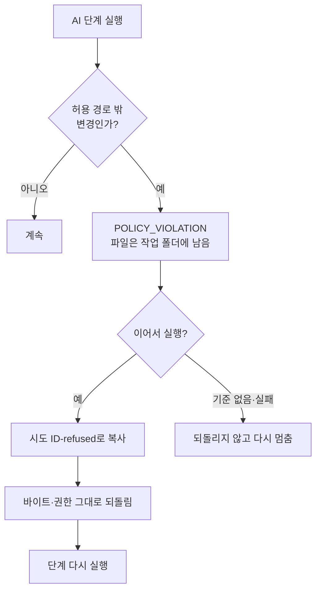

> DevRoster 개발기 시리즈입니다. 전체 목록은 [시리즈 목차](/posts/devroster-series/)에 있습니다.
{: .prompt-info }

새 기능이 없는 글이다. 0.5.0을 내보내기 전후로 정리한 네 가지 작업을 묶었다. 같은 층 안에서 물린 import를 0개로 만들기, 막힌 작업을 이어서 실행할 때 파일을 바이트와 권한 그대로 되돌리기, 인증 값을 파일에서 OS 보안 저장소로 옮기기, Linux에서만 실패한 테스트의 원인인 inode 재사용 막기.

눈에 보이는 변화가 거의 없어서 블로그에 쓰기 애매했는데, 이 네 가지가 이후 기능의 속도를 실제로 바꿨다. 순환에 걸린 코드를 건드릴 때마다 어디가 깨질지 몰라 손이 느려졌던 게 제일 컸다.

## 순환 import를 세는 테스트

2편에서 층 규칙을 AST로 검사한다고 했다. 그 검사는 "adapters가 domain을 부른다" 같은 방향은 잡지만, 같은 층 안에서 A→B→A로 물린 것은 잡지 못한다. 그런 묶음이 하나 있으면 층 규칙 자체가 무의미해진다. 어느 쪽이 위인지 정해지지 않은 상태니까.

`tests/test_architecture.py`가 이제 함수 안 import까지 따라가서 순환 묶음을 찾는다. 처음 검사를 넣었을 때 세 묶음이 나왔다.

| 묶음 | 모듈 수 |
|---|---|
| adapters 작업 공간·워크플로 중심 | 44 |
| adapters CLI (`command_line`, `setup_cli`, `messenger`, `agent_console`) | 4 |
| ui 서버 | 17 |

당시에는 끊지 않고 `KNOWN_CYCLES`에 적어 늘지 않게만 막았다. 새 모듈이 묶음에 끼거나 두 묶음이 합쳐지면 실패하고, 하나를 끊으면 목록에서 지워야 통과한다. 목록을 남겨 두면 "지금 상태"가 테스트에 적혀 있는 셈이라, 줄이는 일도 검사가 시킨다. 2편의 층 예외와 같은 방식이다.

## 44에서 0까지

다섯 PR로 나눠서 남은 44개 묶음을 비웠다.

| 단계 | 한 일 | 남은 모듈 |
|---|---|---|
| 1/5 | CLI 4개와 ui 17개 묶음을 `cli_registry`·`ui/responses.py`·`setup_web.py`로 분리 | 44 |
| 2/5 | 경로·도우미 import를 아래 모듈로 옮김 | 36 |
| 3/5 | 사용량 조회·비용 추정·요구사항 변경 guard를 저장소 아래로 | 33 |
| 4/5 | 설정 신뢰 기록을 검토·승인·등록 목록과 분리 | 21 |
| 5/5 | 남은 절단 4개 | 0 |

쓴 방법은 네 가지다.

쓸 때 같이 쓰는 부분은 아래 모듈로 옮긴다. `private_directory`는 `core/io.py`로, `auth_probe`는 `adapters/cli_auth.py`로 옮겼다.

아래가 위를 불러야 하면 위에서 함수를 넘겨받는다. `WorkflowDefinitions`는 실행 환경을 스스로 만들지 않고 `runtime=`으로만 받는다. 폴더로 만들던 곳은 `adapters/workflow_services.definitions(root)`를 쓴다. 서버가 다른 프로젝트용 서버를 만드는 factory를 생성자로 받는 것도 같은 방식이다.

entry point에서 등록한다. CLI 명령을 `cli_registry`에 entry point가 등록한다. 웹 화면에서 이미 쓰던 방식을 명령에도 적용한 것이다.

여러 모듈을 조립하는 함수는 그 모듈들보다 위에 둔다.

이제 `KNOWN_CYCLES`는 빈 목록이다. 새 순환이 생기면 테스트가 바로 실패한다.

### 옮기다 만난 것

순환을 끊는 일은 import 문을 고치는 일이 아니다. 누가 무엇을 아는지를 바꾸는 일이라, 조용히 깨지는 곳이 몇 군데 있었다.

`cli_auth.auth_probe`는 `project_setup`에서 일부러 다시 내보내지 않았다. 옛 위치를 바꿔치기하는 테스트가 남아 있으면 조용히 통과하지 말고 실패해야 하기 때문이다. 반대로 `workspace_trust`의 승인 함수는 다시 내보내면 순환이 되살아나서, 부르는 쪽을 전부 바꿨다. 같은 "옮기기"인데 한쪽은 일부러 호환을 깨고 한쪽은 호출부를 고쳤다. 기준은 하나였다. 조용히 통과하는 호환은 없앤다.

entry point를 거치지 않고 `command_line.execute(["messenger", ...])`를 직접 부르면 이제 "등록되지 않음" 오류가 난다. 설치된 실행 경로(`devroster`, `fa`, `agent-dev`, `python -m agent_dev`, 데스크톱 앱)는 모두 진입점을 거치므로 동작이 같고, 새 프로세스에서 실제 진입 경로로 messenger 명령을 실행하는 회귀 테스트를 넣었다. 테스트가 부르는 경로와 사용자가 부르는 경로가 다르면 테스트는 통과하고 앱은 깨진다. 그 간극을 메우는 테스트다.

Codex가 찾은 것도 있다. `scripts/smoke_live.py`가 `WorkflowDefinitions(project)`를 그대로 쓰고 있어서 승인 단계에서 `TypeError`로 멈췄다. 테스트가 부르지 않는 스크립트라 내 검색 범위 밖이었다. 리팩토링의 진짜 비용은 이런 데서 나온다.

## 막힌 작업을 이어서 실행할 때

배경부터. AI가 수정 허용 경로 밖 파일을 바꾸면 DevRoster는 `POLICY_VIOLATION`으로 멈춘다. 그런데 그 파일은 작업 폴더에 그대로 남는다. 사용자가 직접 되돌리지 않고 "이어서 실행"을 누르면, 다음 시도가 그 파일을 시작 상태로 잡는다. 그래서 더는 위반으로 보이지 않고, 게시 단계에 가서야 다시 막힌다. 그때는 이미 한참 지난 뒤다.

이제 차단된 단계도 중단된 단계처럼 처리한다. 그 파일만 `.attempts/<시도 ID>-refused`로 복사하고 시도 시작 시점으로 되돌린 뒤 단계를 다시 실행한다. 되돌릴 기준이 없거나 되돌리기가 실패하면 되돌리지 않고 다시 멈추고 직접 되돌리라고 안내한다. 조용히 진행하는 것보다 두 번 멈추는 편이 낫다.



### 되돌리기가 파일을 바꾸면 안 된다

여기서 두 번째 문제가 나왔다. 되돌리기를 `git restore`로 하고 있었는데, 이 명령은 Git 설정을 따른다.

`core.autocrlf`나 `.gitattributes`가 켜져 있으면 원래와 다른 줄바꿈이 쓰인다. Windows 기본값에서 LF 파일이 CRLF로 바뀐다. 0600 같은 파일 권한은 umask 기준으로 다시 만들어진다.

이 기능의 목적은 사용자 파일을 건드리지 않는 것이다. 그런데 되돌리기가 파일을 바꾸면 목적이 깨진다. 되돌리기가 새로운 변경이 되어 버린다. 그래서 시작 상태를 Git 변환 없이 저장하고, 되돌릴 때도 변환 없이 쓴다.

```python
hashes = _git(root, "hash-object", "-w", "--no-filters", "--", *chunk).stdout.split()
for relative, sha in zip(chunk, hashes, strict=True):
    mode = "100755" if (root / relative).stat().st_mode & 0o111 else "100644"
    records.append(f"{mode} {sha}\t{relative}\0")
```
{: file="adapters/role_execution.py (시작 상태 저장, 요약)" }

저장은 `git hash-object -w --no-filters`로 바이트 그대로 blob을 만들고, 임시 인덱스(`GIT_INDEX_FILE`)에 넣어 트리를 만든다. 파일을 200개씩 묶어 부르고, 권한 비트는 따로 기록한다(`"format": 2`). 되돌리기는 저장된 blob을 변환 없이 읽어 임시 파일에 쓰고, 권한을 맞춘 뒤 `os.replace`로 바꾼다. 그다음 시작 때 기록한 해시와 비교해서 다르면 성공으로 기록하지 않고 오류로 멈춘다. 되살릴 파일의 상위 폴더가 심볼릭 링크로 바뀌어 있으면 쓰지 않는다. 역할이 폴더를 링크로 바꿔 두면 파일이 작업 폴더 밖에 쓰일 수 있었다. 0.5.0이 남긴 기준점은 형식 번호로 구분해 지금처럼 `git restore`로 되돌린다.

대소문자만 바꾼 파일도 함정이었다. `Config.txt`를 `config.txt`로 바꾼 경우(대소문자를 구분하지 않는 파일 시스템에서는 같은 파일) 새 경로를 지우는 순서 때문에 복원한 파일까지 지워졌다. 백업 → 새 경로 삭제 → 기준 복원 순서로 바꿨다.

## 인증 값을 파일 밖으로

공통 인증 값(API 키, Slack 토큰)이 관리 폴더의 파일에 평문으로 있었다. 파일 권한 0600은 다른 계정만 막는다. 폴더가 복사·동기화·백업되거나 디스크를 따로 읽으면 값이 그대로 나온다. 이 변경은 0.5.0에 들어갔다.

| 환경 | 값이 있는 곳 | 파일에 남는 것 |
|---|---|---|
| macOS | 로그인 키체인(서비스 이름 `DevRoster`) | 항목의 무작위 이름 |
| Windows + `DEVROSTER_VAULT=os` | DPAPI로 암호화한 값 | 암호화된 값 |
| Windows(기본), Linux, `DEVROSTER_VAULT=file` | 파일 | 값 |

값은 명령 인자가 아니라 표준 입력으로 넘긴다. 인자는 프로세스 목록에서 누구나 볼 수 있다. 저장 직후 다시 읽어 확인하고, 다르면 항목을 지우고 파일 보관으로 돌아간다. "넣었다"고 믿지 않는다. OS 저장소가 거절하거나 값이 너무 길면 파일에 둔다. 키체인은 인자 한 줄 길이 제한(4,000바이트)이 있다. 읽지 못하는 값은 "인증 필요"로 보고하고, 실패를 30초 기억한다. 잠긴 키체인을 화면마다 다시 묻지 않게 하려는 것이다. 이미 파일에 있는 값은 자동으로 옮기지 않고, `devroster doctor --protect-credentials`로 옮긴다.

0.5.0 뒤에 프로젝트 환경변수와 OAuth 액세스 토큰도 같은 곳으로 옮겼다.

`environment.json`은 형식 2로 쓴다. `{"format": 2, "values": 평문, "vault": 항목}` 형태다. 형식 1(평면 객체)도 읽는다. 키체인 항목이 하나도 없으면(Linux, `DEVROSTER_VAULT=file`) 형식 1로 써서 어느 버전에서나 읽힌다. OAuth 액세스 토큰은 키체인에 두고, 파일에는 만료 시각과 대상 주소만 남긴다.

실행은 쓰는 키만 확인한다. 그 실행에 필요 없는 값을 못 읽었다고 실행 전체가 멈추지 않는다. 설정 저장이 실패하면 저장 전 파일 바이트를 그대로 되살리고, 이번 저장에서 만든 항목을 지운다. 설정 화면은 값을 꺼내지 않고 이름만 읽으므로 키체인을 못 읽어도 열린다.

### 이름이 비밀값으로 등록되는 일

전환용 환경변수 이름을 처음에 `DEVROSTER_CREDENTIAL_STORE`로 지었더니 테스트 112개가 실패했다. DevRoster는 이름에 KEY·TOKEN·CREDENTIAL이 들어간 환경 변수의 값을 비밀로 등록해 모든 출력에서 가리는데, 그 이름 때문에 값 `file`이 전부 가려진 것이다. `DEVROSTER_VAULT`로 바꾸고, 같은 일이 다시 생기지 않도록 테스트를 추가했다. 비밀값 가리기가 제 일을 너무 잘해서 개발자를 잡은 셈이다.

한계도 적어 둔다. 같은 사용자로 실행되는 다른 프로그램은 OS가 값을 내주므로 여전히 읽을 수 있다. 관리 폴더를 통째로 지워도 키체인 항목은 남는다(이름 없이는 쓸 수 없는 항목이다).

## Linux에서만 실패한 테스트

4편에서 다룬 inode 재사용 문제의 구현 쪽이다. 설정 신뢰는 state DB를 `[장치, inode]`로 가리키는데, Linux 파일 시스템은 지운 파일의 inode 번호를 다음 새 파일에 다시 준다. 신뢰한 경로의 DB를 지우고 다른 DB를 같은 경로에 두면 같은 파일로 판정될 수 있었고, 그건 저장소와 함께 온 설정이 확인 없이 신뢰되는 길이다.

고친 방법은 Linux에서 파일 생성 시각(`btime`)을 더해 `[장치, inode, 생성 시각]`으로 남기는 것이다. 구현에서 신경 쓴 것들이다.

`statx`를 ctypes로 부르고 `struct statx`를 직접 읽는다. `stx_mask`로 btime 지원 여부를 보고, `stx_ino`와 `stx_btime`(초 + 나노초)을 꺼낸다.

inode generation(`FS_IOC_GETVERSION`)은 쓰지 않았다. 파일을 열어야 하고, DB 파일을 열었다 닫으면 같은 프로세스가 SQLite로 잡은 POSIX 잠금이 풀린다. 신뢰를 판정하려고 파일을 열었다가 다른 문제를 만드는 건 바꿀 수 있는 실수가 아니다.

신뢰 파일 형식은 1에서 2로 올렸다. 형식 1의 결정은 그 경로의 파일이 여전히 같은 `[장치, inode]`일 때 한 번만 새 식별자로 옮긴다. 그래서 기존 사용자는 다시 신뢰할 필요가 없다.

남는 한계는 생성 시각을 알려 주지 않는 파일 시스템(일부 네트워크·FUSE 마운트, inode 128바이트 ext4)이나 `statx`가 없는 libc에서는 장치·inode만 쓴다는 것이다.

이 패치는 개발 컴퓨터에서 재현할 수 없었다. macOS(APFS)와 Windows(NTFS)는 inode 번호를 다시 주지 않는다. 실패한 테스트를 "불안정하다"고 넘기지 않았기 때문에 막을 수 있었다.

## 정리하며

테스트에 지금 상태를 적어 두면 줄이는 일이 임무가 된다. `KNOWN_CYCLES`는 그냥 통과시키는 목록이 아니라 0으로 가야 할 빚이었다. 남은 수를 표에 적어 두니 다음 PR이 자연스럽게 정해졌다.

되돌리기는 파일을 바꾸지 않아야 한다. 목적과 수단이 어긋나면 조용히 어긋난다. `git restore`가 줄바꿈을 바꾼다는 걸 Windows 검토에서야 알았다.

비밀은 "안 보이게"가 아니라 "안 남게"다. 파일 권한은 사본을 막지 못한다.

개발 컴퓨터에서 안 나오는 실패가 진짜 실패다. inode 재사용도, 줄바꿈 변환도, 키체인 잠금도 macOS에서는 드러나지 않았다. 플랫폼을 늘려 잡은 게 이 시리즈에서 가장 값싼 보험이었다.

- 이전: [SI 납품 산출물 파이프라인과 브라우저 콘솔 오류](/posts/devroster-08-deliverables-and-console/)
- 처음으로: [시리즈 목차](/posts/devroster-series/)
