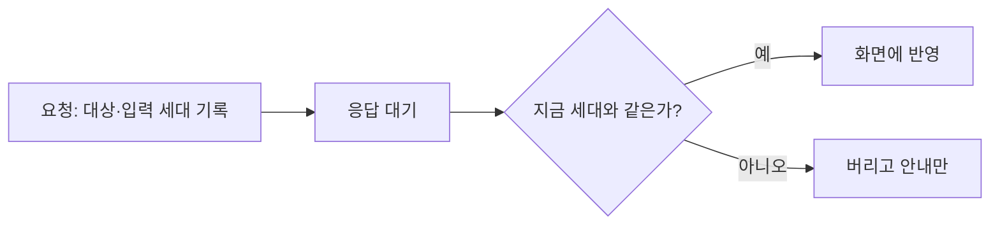

> DevRoster 개발기 시리즈입니다. 전체 목록은 [시리즈 목차](/posts/devroster-series/)에 있습니다.
{: .prompt-info }

이번 글에는 새 기능이 거의 없다. 화면 배치를 다시 그린 기록이다. 기능은 계속 늘었는데 그 기능이 어디 있는지는 어디에도 적혀 있지 않았고, 같은 작업이 화면마다 다른 이름으로 불렸다. 열 개 단위로 쪼개서 PR 여덟 개(#133, #135~#141)로 끝냈다. 0.5.0을 공개한 뒤에 이어진 작업이라 공개된 0.5.0에는 들어 있지 않다.

처음에는 메뉴 이름만 바꾸는 일이라고 생각했다. 실제로는 그 반대였다. 메뉴를 소유 범위로 나누고 나니 "이 설정은 누구의 것인가"를 코드가 답해야 했고, 화면을 합치고 나니 같은 상태를 두 곳이 다르게 계산하고 있던 것이 드러났다. 절반은 화면 일이고 절반은 서버 일이었다.

## 메뉴를 소유 범위로 나눈다

바꾸기 전 메뉴는 기능이 생긴 순서대로 늘어나 있었다. 공통 설정은 메뉴에 나오지 않았고, 위키 승인은 개발 그룹으로 옮겨야 했다. 그래서 메뉴를 "누구의 것인가"로 다시 나눴다. 다섯 묶음, 열여섯 항목이다.

| 묶음 | 항목 |
|---|---|
| 홈 | 프로젝트 홈 |
| 기획 | Studio |
| 개발 | 작업실, 변경 검토, 요구사항, 납품 문서, 위키 승인, 소스 탐색, 사용량·진행 |
| 이 프로젝트 설정 | 프로젝트 설정, 개발 흐름 정의, 외부 도구 연결, 화면 참고 자료 |
| 모든 프로젝트 공통 | AI 도구, 공통 설정, 메신저 |

기준은 하나다. 이 프로젝트를 바꾸는 것과 이 컴퓨터 전체를 바꾸는 것을 섞지 않는다. 메신저 봇 토큰이나 AI 도구 로그인은 프로젝트를 넘어가고, 개발 흐름과 화면 참고 자료는 그 프로젝트에만 붙는다. 이 구분은 나중에 공통 설정 화면을 만들 때 그대로 서버 규칙이 됐다.

주소는 하나도 바꾸지 않았다. `/dashboard`는 작업실을, `/changes`는 요구사항을 가리키는 별칭으로 남겼다. 북마크를 깨지 않으려는 것도 있지만, 더 큰 이유는 그 두 화면이 각각 독립 서버로 뜨기 때문이다. 주소를 합치면 서버를 합쳐야 한다.

```js
const aliases = { '/dashboard': '/agent', '/changes': '/traceability' };
```
{: file="ui/assets/navigation.js (요약)" }

폭에 따라 모양도 셋으로 나뉜다. 1440px 이상은 글자까지 나오는 사이드바, 1024~1439px는 아이콘만 있는 레일(마우스를 올리면 이름이 뜬다), 1023px 이하는 메뉴 버튼으로 여는 서랍이다. 1024px가 레일과 서랍의 경계라서, 브라우저 테스트도 1440·1024·768·390px 네 폭으로 돌린다.

### 작업 링크가 다른 작업을 열던 문제

작업실은 `?task=`로 작업을 지정할 수 있었는데, 여기에 두 가지가 더 붙어 있었다. 예전 화면이 쓰던 `?task_id=`와, 홈에서 넘어올 때 쓰는 `#task=`다. 셋 다 같은 작업을 골라야 하는데 `#task=`는 아예 읽지 않고 있었다.

```js
const requested = params.get('task') || params.get('task_id') || hashTask;
```
{: file="ui/assets/agent.js (요약)" }

둘 다 있으면 `task`가 이긴다. 작업 ID는 자유 문자열이라 공백이나 `&`가 들어갈 수 있으므로 홈의 링크는 `URLSearchParams`로 만든다. 여기서 조용한 실수가 하나 있었다. 링크가 가리키는 작업이 목록에 없을 때 첫 번째 작업을 대신 열어 주고 있었다. 사용자는 자기가 누른 작업이 열린 줄 안다. 이제는 다른 작업을 고르지 않고 "요청한 작업 …을(를) 이 작업 공간의 목록(처음 100개)에서 찾지 못했습니다"를 띄운다.

## 같은 작업이 화면마다 다른 말을 하던 것

메뉴를 정리하고 나니 더 눈에 띄는 것이 있었다. 같은 작업이 홈에서는 "대기", 작업실에서는 "승인 대기", 대시보드에서는 또 다른 문구로 보였다. 상태별 다음 행동도 화면마다 달랐다. 같은 상태에서 어떤 화면은 게시를, 다른 화면은 검토를 권했다.

상태 문구와 묶음을 `domain/status.py` 한 곳으로 모으고, 다음 행동은 `adapters/task_guidance.py`가 정하게 했다. 홈·작업실·대시보드·사용량·CLI 제안 명령이 모두 이 결과를 쓴다.

| 상태 | 문구 | 묶음 | 다음 행동 |
|---|---|---|---|
| ready | 실행 준비 | 진행 중 | 실행 |
| waiting_for_capacity | AI 사용량 대기 | 진행 중 | 이어서 실행 |
| verifying | 검증 중 | 진행 중 | 검증 실행 |
| blocked (단계 승인 대기) | 차단됨 | 조치 필요 | 작업실의 단계 승인 칸 열기 |
| pr_ready | 게시 준비 | 확인·승인 필요 | 게시(필수 저장소가 아직 안 올라갔을 때) 또는 검토 상태 확인 |
| user_review | 사용자 검토 | 확인·승인 필요 | 완료 — 게시 기록 ID를 자동으로 채운다 |

여기서 규칙 두 개를 정했다.

첫째, 게시가 필요한지는 작업 정의의 `publish_required`를 따른다. 저장소가 셋인 작업에서 하나만 올렸으면 다음 행동은 여전히 게시이고, 어느 저장소인지까지 버튼 옆에 적는다. 예전에는 게시 여부를 다음 행동에 반영하지 않아서, 검증이 끝난 작업을 완료로 오해하고 게시를 건너뛰기 쉬웠다.

둘째, 실행이 꺼져 있거나 준비 모드면 실행 버튼 대신 이유와 해결 방법을 준다. AI 설정을 읽지 못하는 경우는 준비 모드로 본다. 실행을 막는 쪽으로 판단한다는 뜻이다(fail closed). 이 판단이 없으면 설정이 깨진 상태에서 AI를 부르고, 실패는 실행한 뒤에야 나온다.

목록 전체의 사실은 한 번에 읽는다. 작업 100개를 그리면서 행마다 쿼리를 날리면 화면이 느려지는 정도가 아니라, 목록을 그리는 코드가 상태 계산 코드와 뒤엉킨다. 승인 대기 노드, 게시 기록, 필수 저장소를 목록당 쿼리 세 개로 모았다.

## 단계 승인을 작업실로 옮기면서 생긴 경쟁

가장 큰 변경은 단계 승인이다. 개발 흐름 화면에서만 할 수 있던 승인을 작업 상세 안으로 옮겼다. 그리고 승인은 **기록만** 한다. 승인하면 바로 다음 단계가 도는 게 아니라, "이어서 실행"을 눌러야 진행한다. 승인 하나가 실행을 시작하면 그 승인이 어떤 작업을 시작했는지 화면에 남지 않기 때문이다.

옮기면서 경쟁 조건을 여럿 만났다.

- 승인 화면을 열어 둔 사이 선택 회차가 바뀔 수 있다. 승인 요청에 회차를 고정해 보내고, 서버가 그 회차와 다른 결정을 이미 받았으면 409로 돌려준다.
- A 작업을 보다가 B로 갔다가 다시 A로 돌아오는 경우가 있다. 응답이 늦게 오면 지금 보고 있는 회차와 비교해서 버린다.
- 폴링이 3초마다 목록을 다시 그린다. 그 사이 사용자가 결정 메모를 쓰고 있으면 폴링이 입력을 지우면 안 된다. 입력 중인 값은 폴링 결과와 별도로 들고 있는다.
- 확인 대화상자에서 확인을 누른 직후 다시 조회해서 상태·generation·버전이 같은 때만 기록한다. 다른 곳에서 먼저 결정했으면 실패로 알리고 최신 상태를 보여 준다.

승인 뒤 자동 재개는 하지 않기로 했다. 대신 "반려"는 막힌 채로 남는다. 반려된 단계가 있는데 다른 단계가 승인 대기 중이면 이어서 실행해도 진행되지 않으므로, 그때는 승인 버튼 대신 반려 내용을 먼저 보여 준다.

개발 흐름 화면은 정의와 실행으로 탭을 나눴다. `?tab=`이 있으면 그 탭, 없고 `?task=`가 있으면 실행 탭이다. 실행 탭은 그 작업에 고정된 그래프를 따로 그린다. 예전에는 편집 중인 초안이 실행 그래프 위에 덧칠돼서, 지금 도는 흐름이 어느 것인지 알 수 없었다.

정의 탭에는 미저장 확인을 붙였다. 단계 입력을 적용하지 않았거나 초안을 저장하지 않았으면 버리기 전에 묻고, 그 상태에서는 검사·미리보기·저장·적용·내보내기를 막는다. 열기·저장·적용·목록 응답이 늦게 도착해서 새 초안을 덮는 경우도 막았다.

## 설정 화면을 단계로 쪼개기

`/setup`은 한 장짜리 긴 폼이었다. 스크롤을 끝까지 내려 저장을 누르면, 중간에서 잘못 입력한 값 하나 때문에 전체가 저장되지 않았다. 무엇이 문제인지도 그 자리에서 알 수 없었다.

지금은 단계마다 따로 저장한다. 각 단계는 자기가 소유한 필드만 모아서 보낸다.

```js
const STEP_COLLECT = {
  project: () => ({name: ..., project_id: ..., create_directories: ..., modules: ...}),
  ai: () => ({context_policy: ..., ai: ..., ai_tools: ...}),
  roles: () => ({roles: state.roles}),
  guidance: () => ({skills: collectSkills()}),
  development: () => ({verification: ..., preview_services: ..., usage_policy: ..., limits: ..., ports: ...}),
  environment: () => ({environment: ..., environment_classified: ...}),
};
```
{: file="ui/assets/setup.js (요약)" }

저장 요청은 "저장된 설정 + 이 단계의 초안"이다. 응답이 오면 저장된 단계만 다시 그리므로, 다른 단계에서 입력하던 값이 날아가지 않는다. 저장은 한 번에 하나만 진행하고, 저장 중에는 폼을 잠근다.

충돌은 이렇게 처리한다. 다른 탭에서 먼저 저장했으면 409가 오는데, 이때 화면의 입력은 그대로 두고 저장된 설정만 다시 읽는다. 사용자가 쓴 것을 버리는 대신, 무엇이 기준인지 새로 읽는 쪽을 골랐다. 안내 문구도 "화면의 입력은 그대로 두었습니다"로 시작한다.

모듈 목록을 바꾸면 예외가 생긴다. 검증 명령, 미리보기 서비스, 스킬 저장소 연결이 모듈을 따라가기 때문이다. 그래서 모듈을 바꿔 저장할 때는 그 단계들을 함께 저장할지 묻는다. 사라진 모듈을 가리키는 값에는 "없는 모듈" 표시를 붙이고 저장을 막되, 모듈 이름을 되돌리면 복구된다.

처음에는 이걸 자동으로 고쳐 주게 만들었다. 모듈 이름이 바뀌면 다른 단계의 값도 같이 바꿔 주는 방식이다. Codex 검증에서 예외 사례가 계속 나왔다. 이름을 바꿨다가 되돌린 경우, 같은 이름의 모듈이 둘인 경우, 화면에 칸이 없어서 만질 수 없는 모듈의 연결 같은 것들이다. 결국 자동 보정을 걷어내고 "바꾸지 않고 막고 알려 준다"로 다시 설계했다. 저장이 안 되는 편이 조용히 틀린 설정이 저장되는 것보다 낫다.

AI 편집은 `/ai`로 뺐다. 공통 AI 도구를 쓰는 프로젝트에서 모델·추론 강도·작업별 자동 선택을 고치는 자리다. `/setup#ai`에는 지금 값만 읽기 전용으로 보이고 `/ai`로 가는 링크가 있다. 스킬·규칙은 새 "AI 지침" 단계(`#guidance`)로 옮겨서 단계가 여섯에서 일곱이 됐다. 전환 전 프로젝트는 계속 `/setup`에서 편집한다.

### 공통값을 반영하기 전에 보여 주기

`/settings`는 두 탭이 됐다. "공통 기본값·연결"과 "유지관리"다. 구역 hash로 들어오면 그 탭이 열리고, 탭을 고를 때만 주소를 바꾼다(뒤로가기 기록을 탭마다 쌓지 않으려고). 숨겨지는 패널에 포커스가 남아 있으면 탭으로 옮긴다.

더 큰 변경은 공통값 반영이다. 공통 설정을 프로젝트에 반영하는 일은 조용히 하면 안 되는 종류다. 실행 한도가 낮아지거나, AI 도구가 바뀌거나, 개발 흐름이 다시 만들어진다. 그래서 미리보기와 반영을 나눴다.

- 미리보기(`POST /api/settings/apply-global/preview`)는 쓰지 않고, 바뀌는 항목과 경고를 계산해 `preview_digest`를 돌려준다.
- 반영은 그 digest를 함께 보내고, 서버가 같은 계산을 다시 해서 다르면 409로 거절한다. 미리보기와 반영 사이에 공통 상한이 낮아진 경우도 여기서 걸린다.
- 미리보기 뒤에만 반영 버튼이 켜진다. 확인 대화상자에는 몇 개 항목이 바뀌는지 적는다. 이 변경은 새 프로필 버전을 만드는 것이라 되돌릴 수 있으므로 Ctrl/⌘+Enter 확인을 허용했다.
- 대상 해석은 한 함수가 한다. 절대 경로인지, 이 작업 공간이거나 등록된 프로젝트인지, 서버가 정한 설정 위치가 그 폴더와 맞는지. 목록·유효값·미리보기·반영이 모두 이 함수(`settings_target`)를 쓴다. 네 곳이 각자 경로를 해석하면 언젠가 한 곳만 틀린다.

경고 문구도 같이 계산한다. "이 프로젝트는 공통 AI 도구 방식이라 AI 값은 저장되지만 실행에는 /ai 설정이 쓰입니다", "실행 한도 X가 공통 상한 Y로 낮아집니다", "개발 흐름이 다시 만들어집니다".

컴퓨터 전체 설정인 API 가격 목록 자동 갱신은 `/setup`에서 `/settings#prices`로 옮겼다. 프로젝트 설정 화면에 있으면 프로젝트별 설정처럼 보인다. `/setup`에는 상태와 링크만 남겼다.

### 연결·참고 자료·메신저의 경계

`/integrations#shared`가 생겼다. 공통 MCP 연결을 "이 프로젝트에서 쓴다"고 지정하는 자리인데, 원래 `/settings`에 있었다. 공통 정의를 고치는 곳과 이 프로젝트에서 쓰는 곳은 다른 일이다.

지정 대화상자는 버전을 고르고, 공통 정의가 허용한 자료 범위와 도구를 체크로 줄이고, 인증 참조를 고른다. 인증 참조 후보에서 일반 설정으로 분류한 환경변수는 빼고, 읽을 수 없는 키는 선택할 수 없게 했다. 서버가 내려주는 목록(`GET /api/integrations/shared`)에는 허용 필드만 담는다. `endpoint`·`command`·고정 인수·환경변수 이름·비밀값은 넣지 않는다.

지정 요청(`POST /api/integrations/shared-bind`)은 클라이언트가 root를 보내지 않는다. 그 서버의 작업 공간으로만 동작하고, 실제 저장은 기존 `SharedIntegrations.bind()`에 넘긴다. 화면이 자기 작업 공간을 벗어나 다른 프로젝트 설정을 건드리지 못하게 하려는 것이다. 409면 대화상자의 초안을 지키고 최신 상태를 다시 읽어 보여 준다.

`/references`는 적용 대상을 둘로 나눴다. "Studio 기획 버전에 연결"과 "프로젝트 개발 흐름 참고"다. 연결하기 전에 대상 버전을 한 번 읽어서(`GET /api/design-references/attach-target`) 화면에 보이고, 그 버전 그대로 보낸다. 보여 준 뒤에 기획 프로젝트가 바뀌면 409로 막고 다시 읽으라고 한다. Studio 오류의 403·404·409·413을 그대로 전달하도록 바꾼 것도 이때다. 예전에는 전부 400이 되어서, 충돌인지 권한인지 화면이 구분할 수 없었다.

`/messengers`에는 저장 범위를 표시했다. 봇 토큰은 이 컴퓨터 공통, 채널·허용 대상·명령·리스너는 이 프로젝트다. 그리고 승인 명령을 켤 때 위험 확인을 받는다. 다만 이 확인은 화면의 방어다. 설정 파일을 직접 고치거나 CLI로 켜면 확인이 없다. 문서에 그렇게 적었다.

## 늦은 응답을 버리는 규칙 하나

이 개편에서 반복해서 나온 버그가 늦은 응답이다. 사용자가 A를 보고 있는데 B를 눌렀다가 A로 돌아오면, B의 응답이 나중에 도착해서 A 화면을 덮는다. 화면마다 다른 방식으로 막고 있었는데, 규칙을 하나로 정리했다. 요청을 보낼 때 대상과 입력의 세대 번호를 찍어 두고, 응답이 왔을 때 그 번호가 지금과 다르면 버린다.

```js
const snapshot = {targetGen: state.targetGen, inputGen: state.inputGen, body: applyPayload()};
const current = () => snapshot.targetGen === state.targetGen && snapshot.inputGen === state.inputGen;
```
{: file="ui/assets/settings.js (요약)" }

작업실은 세대가 셋이다. 작업 상세(`overviewGeneration`), 실행 결과(`resultGeneration`), 미리보기 요청·입력(`inputGeneration`, `previewRequest`). 설정 저장은 `saveSeq` 하나로 저장 순서를 보고, 참고 자료 연결은 대상·입력 세대를 본다. 전부 같은 문제를 푸는 장치인데 이름이 다르다. 나중에 네 번째 화면이 생기면 또 만들 텐데, 그때는 공용 부품으로 뺄 생각이다. 지금은 각 화면의 상태 모양이 달라서 억지로 합치면 오히려 헷갈린다.



조용한 실패를 남기지 않으려고 안내도 붙였다. "미리보기 중 입력이 바뀌어 결과를 버렸습니다. 다시 미리보기해주세요", "확인하는 동안 대상이나 입력이 바뀌었습니다". 버린 결과를 말없이 버리면 사용자는 버튼이 안 먹은 걸로 본다.

## 인계 준비 판단은 한 곳에서

Studio에서 개발로 넘기는 조건은 세 곳이 판단하고 있었다. 인계 등록, 최종 ZIP, Studio 화면이다. 셋이 조금씩 달랐다. 화면은 "준비됨"인데 등록은 거부되고, ZIP은 받아졌다. 가장 나쁜 조합이다.

`domain/handoff_readiness.py`의 순수 함수 하나로 모았다. 입력은 DB 스냅샷 하나이고, 조건마다 `{key, label, ok, detail, code, message}`를 돌려준다. 등록이 던질 오류 코드와 문구를 그 자리에 같이 넣어서, 화면이 보여 주는 이유와 거부 문구가 어긋나지 않게 했다.

여기서 동작이 하나 바뀌었다. 독립 검토의 어느 관점이든 열린 high 지적이 있으면 이제 **최종 인계 ZIP도 409**다. 예전에는 등록만 막고 ZIP은 내줬다. 일반 명세 ZIP은 그대로다.

Studio 화면의 주소도 상태를 갖게 됐다. `?step=`과 `?view=`로 단계와 문서/목업 화면을 지정할 수 있다. 같은 프로젝트 안에서 움직이는 것은 다시 불러오지 않는다. 초안이나 과거 버전을 보고 있었는데 이동했다고 사라지면 곤란하다. 다른 프로젝트로 가는 뒤로가기·앞으로가기는 미저장 입력을 확인하고, 취소하면 원위치로 돌린다. 이 확인 중에 또 이동을 누르면 무시한다.

명세서 화면은 1024px 이상에서 세 칸이 각자 스크롤된다. 세 칸을 나란히 놓으면 하단 조작부가 프레임 밖으로 잘렸다. 겹침·잘림·내부 스크롤을 1440×900과 1024×700 두 크기로 확인했다.

## 검증

단위마다 PR 하나로 올렸고, 단위마다 전체 테스트를 다시 돌렸다. 브라우저 테스트는 Playwright로 1440·1024·768·390px 네 폭에서 가로 넘침과 키보드 조작을 본다. 이 개편에서 새로 만든 브라우저 점검 파일이 일곱 개다. 탐색(`ia_navigation_browser.cjs`), 상태 안내(`task_guidance_browser.cjs`), 단계 승인(`step_approval_browser.cjs`), Studio 주소(`studio_address_browser.cjs`), 설정 단계 저장(`setup_steps_browser.cjs`), 설정 탭과 공통값 반영(`settings_tabs_browser.cjs`), 연결·참고 자료(`connections_references_browser.cjs`).

마지막 단위에서 전체 3308건 통과, 5건 건너뜀이다. 커버리지 하한 검사까지 포함해서다.

못 돌린 것도 적어 둔다. GitHub Actions의 Windows·Linux 실행(portable)이 결제 문제로 돌지 않아서, 그 세 단위는 로컬 CI(`scripts/ci_local.py`)로 대신했다. 플랫폼별 차이는 이번 개편의 주제가 아니지만, 검증하지 않은 것을 검증했다고 쓰지 않는다.

## 정리하며

메뉴는 기능 목록이 아니라 소유 범위로 나눈다. "이 프로젝트 것"과 "이 컴퓨터 전체 것"을 섞으면 설정 화면에서 반드시 사고가 난다. 다섯 묶음으로 나누고 나니 공통값 반영 대상을 서버가 판단해야 한다는 것도 자연스럽게 따라왔다.

화면 경계는 데이터 경계다. 같은 상태를 두 화면이 각자 계산하면 언젠가 다르게 계산한다. 정본 하나를 정하고 나머지가 그것을 읽게 하면, 화면을 하나 더 만들어도 규칙이 늘지 않는다.

합치는 일은 경쟁 조건을 만든다. 화면 하나에 조작이 모이면 늦은 응답이 다른 화면을 덮는다. 세대 번호는 그때마다 새로 발명하는 대신 규칙으로 정해 두는 편이 낫다. 이번에는 화면마다 이름이 달라서 그렇게 하지 못했지만, 다음 화면을 만들 때는 공용 부품으로 간다.

자동으로 고쳐 주는 기능은 조용히 틀린다. 모듈 이름 변경을 자동 보정하다가 예외를 다 열거할 수 없다는 걸 확인하고 "막고 알려 준다"로 바꿨다. 저장이 한 번 실패하는 편이, 틀린 설정이 저장돼서 나중에 실행에서 터지는 것보다 낫다.

- 이전: [순환 참조 0개, 파일 원복, OS 키링](/posts/devroster-09-hardening-and-cycles/)
- 다음: [AI가 테스트를 약하게 만들거나 비밀값을 흘릴 때](/posts/devroster-11-weakened-tests-and-secrets/)
