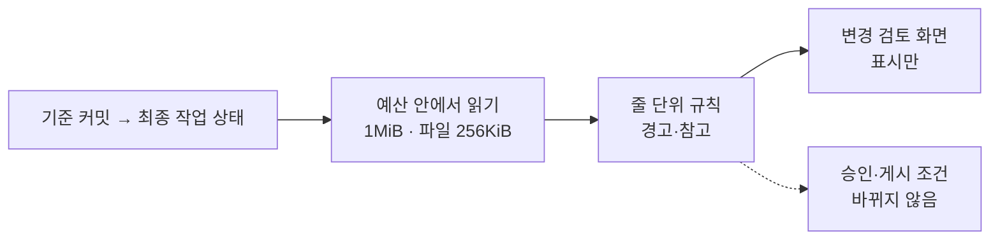

> DevRoster 개발기 시리즈입니다. 전체 목록은 [시리즈 목차](/posts/devroster-series/)에 있습니다.
{: .prompt-info }

AI가 만든 변경을 사람이 한 줄씩 다 읽지 않는다. 읽지 않으면서도 괜찮으려면, 조용히 나빠지는 종류의 변경을 기계가 먼저 보여 줘야 한다. 이번에 다룬 것은 그런 조용한 실패 두 가지다. 테스트가 약해지는 것과, 등록한 비밀값이 가려지지 않은 채 밖으로 나가는 것.

T-19, T-20, T-25, T-27 네 작업이 중심이고, 문서만 바꾼 T-21을 함께 넣어 PR은 #117부터 #123까지다. 0.5.0을 공개한 뒤에 이어진 작업이라 공개된 0.5.0에는 없다.

두 문제의 대응은 반대다. 테스트 약화는 경고만 하고 판단은 사람에게 남긴다. 비밀값은 확인이 안 되면 작업을 멈춘다. 되돌릴 수 있는 것과 되돌릴 수 없는 것의 차이다.

## 테스트가 약해지는 것을 어떻게 아나

테스트 코드는 줄이면 조용하다. `assert` 하나를 지워도 pytest는 초록색을 낸다. 테스트 함수 하나를 `skip`으로 바꿔도 그렇다. 커버리지가 떨어지면 보이겠지만, CI에서 커버리지 하한을 걸어 둔 프로젝트는 드물고, 걸어 두어도 "이번 변경이 테스트를 약하게 만들었다"고는 말해 주지 않는다.

그래서 변경에서 약화의 흔적을 찾는 규칙을 따로 만들었다. `domain/weakening_signals.py`, 순수 함수다. 입력은 기준 커밋에서 최종 작업 상태까지의 파일별 변경(지운 줄과 추가한 줄, 줄 번호)이고, 출력은 신호 목록이다. DB도 Git도 여기서는 모른다.

경고로 올리는 것:

- assert가 줄어든 테스트 파일
- 없어진 테스트 이름
- 새로 생긴 건너뛰기 — `skip`·`xfail`·`.only`·`todo`, `@Disabled`, `t.Skip`, `#[ignore]`, `[Fact(Skip=…)]`, Jest의 수식어 사슬(`test.concurrent.skip.each(…)`)까지
- 테스트 파일 삭제
- 테스트 파일을 테스트가 아닌 이름으로 바꾸거나 링크 같은 다른 형식으로 바꾼 경우
- 기존 코드를 주석으로 만드는 블록 주석·삼중 따옴표·`=begin` 경계의 추가·이동·삭제

참고로 낮추는 것:

- 같은 모듈의 다른 파일로 옮긴 것으로 보이는 assert와 테스트 파일
- 개수는 줄지 않은 assert 변경
- 조건부 건너뛰기(`skipif` 등)
- 테스트 설정·자료 파일 변경(`[tool.pytest…]` 구역 안의 값 변경 포함)
- 읽기 예산이나 범위 때문에 일부만 검사한 경우

지원 언어는 Python, JS/TS, Go, Java/Kotlin, C#, Rust, Ruby 일곱이다. 언어마다 assert와 skip의 모양이 달라서 정규식을 언어별로 나눠 두었다. 예를 들어 Go의 `t.Skip()`와 Rust의 `#[ignore]`, C#의 `[Fact(Skip="…")]`는 이름만 보고는 같은 일인지 알 수 없다.

```python
return {
    "items": items,
    "warnings": sum(i["level"] == "warning" for i in items),
    "notices": sum(i["level"] == "notice" for i in items),
    "checked": len(tests),
    "truncated": truncated,
    "complete": not unchecked and not any(c.incomplete for c in changes),
}
```
{: file="domain/weakening_signals.py (요약)" }

`complete`가 따로 있는 이유는 뒤에 나온다. 검사를 다 하지 못한 결과를 "신호 없음"으로 보여 주면 안 되기 때문이다.

### 오탐을 줄이는 기준

줄 단위 규칙의 약점은 리팩터링을 약화로 읽는다는 것이다. 들여쓰기를 바꾸거나 순서를 바꾸면 같은 assert가 지워지고 추가된 것처럼 보인다.

그래서 같은 파일 안에서 같은 줄(공백을 정규화한 텍스트)이 지워지고 다시 생기면 상쇄한다. 같은 모듈의 다른 파일에 똑같은 assert가 생기면 "옮긴 것으로 보임"으로 낮춘다. 추가된 줄 하나는 한 번만 근거로 쓴다. 그렇지 않으면 같은 assert 하나가 여러 경고를 상쇄한다.

JSDoc이나 docstring처럼 사이 줄까지 전부 새로 쓴 주석은 경고하지 않는다. 다만 그 안쪽 줄이 이번에 지운 줄과 같으면 경고한다. 함수를 통째로 주석 처리한 경우를 놓치지 않으려는 것이다.

반대로 애매하면 경고 쪽으로 판단한다. 지운 assert와 skip은 줄 전체에서 찾고, 삭제를 상쇄하는 추가 assert는 실제 코드에서만 센다. 문자열 안이나 줄 끝 주석으로 옮긴 assert는 실행되지 않으니 줄어든 것으로 본다.

한계는 문서에도 적었다. assert를 helper로 묶거나 여러 테스트를 parametrize로 합치면 경고가 뜬다. 리팩터링이라면 무시하면 된다. 반대로 개수는 그대로 두고 약하게 바꾼 assert, 여러 줄 문자열 안의 코드, 지원하지 않는 언어는 찾지 못한다. 줄 단위 비교로는 assert의 의미를 판단할 수 없다. 이 기능은 "여기를 보라"고 표시하는 것이지 판정하는 것이 아니다.

승인 조건은 바꾸지 않았다. 경고가 있어도 승인과 게시는 그대로 된다. 판단은 사람이 한다.

### 읽는 쪽

신호를 만드는 쪽과 읽는 쪽을 나눴다. 읽는 쪽(`adapters/development_review.py`)이 Git에서 변경을 가져온다.

- 모듈마다 기준 커밋(없으면 HEAD) 대비 작업 트리 diff를 읽는다. 커밋·스테이징·작업 중을 합친 최종 상태만 본다.
- 허용 범위 안의 테스트·설정 파일만 읽는다. 지웠거나 형식이 바뀐 파일은 링크 검사로 숨기지 않는다.
- 읽기 예산은 전체 1MiB, 파일 하나 256KiB다. 실제로 읽은 바이트를 뺀다. 넘치면 그 파일부터 "일부만 검사"로 표시한다.
- 잘린 patch의 마지막 줄과 잘린 이름 목록의 조각은 버린다. 잘린 줄을 규칙에 넣으면 없는 assert를 지운 것으로 읽을 수 있다.

가림은 규칙 다음이다. 규칙은 원래 줄로 판단하고, 응답에 보이는 문구만 가린다. 줄마다 등록된 비밀값을 가리고, 여러 줄 비밀값의 줄과 개인 키 블록(끝이 잘린 것 포함)은 그 줄 전체를 가린다. base64 문자 40자 이상이 이어지는 줄과 그 옆의 짧은 키 끝줄도 가린다. 가린 뒤 200자로 자른다.

이 순서가 중요했다. 가림을 먼저 하면 비밀값 안에 들어 있는 `skip` 글자가 사라져서 규칙이 못 본다. 반대로 규칙을 먼저 하면 응답에 비밀값이 실린다. 그래서 규칙은 원문으로, 표시는 가림본으로 한다.

처리 시간은 줄 수에 비례한다. 같은 줄이 대량으로 있거나 비밀값이 반복돼도 마찬가지가 되도록, 가림도 줄마다 한 번만 훑게 만들었다.

### 가림이 테스트 문구를 잡은 일

2/2(화면)를 올리고 전체 테스트를 돌렸더니 한 건이 실패했다. 이 PR의 브라우저 테스트였다. 원인은 1/2에서 새로 넣은 가림 규칙이었다. base64 문자 40자 이상 연속을 가리는데, 테스트 문구에 쓰던 `yyyy…`가 그 조건에 걸렸다.

가림 기능이 자기가 만든 테스트를 잡은 셈이다. 테스트 문구를 바꿔서 해결했지만, 이 실패는 남겨 둘 만했다. 가림 규칙을 넣을 때는 그 규칙이 무엇을 같이 지우는지 봐야 한다. 실제 값이 아닌 문자열을 지우는 것은 안전한 방향의 실수지만, 화면에 `****`만 보이면 사용자는 무엇이 문제인지 알 수 없다.



## 커밋이 생기는 곳

다음은 테스트 약화와 다른 종류의 조용한 문제다. 작업 브랜치에 DevRoster가 만들지 않은 커밋이 쌓이는 경우다.

먼저 "재시도가 커밋을 쌓는가"를 확인했다. 코드를 따라가 보고, 로컬 실험을 하고, Codex에 반박 검토를 시켰다. 결론은 쌓이지 않는다는 것이었다. DevRoster는 게시할 때만, 작업·저장소당 커밋 하나를 만든다. AI 도구는 git을 직접 실행할 수 없다. 그래서 squash 병합 옵션은 만들지 않았다. 문제가 없는 것을 고치면 설정만 늘어난다.

그런데 커밋이 생기는 경로가 따로 있었다.

- 검증 명령이나 훅이 실행한 `git commit`
- 저장소의 git 훅
- 사용자의 수동 커밋
- 기본 브랜치를 반영해서 들어온 커밋

이런 커밋이 모르게 게시되면 안 된다. `worktrees.foreign_commits`가 `base_commit..HEAD`에서 DevRoster 게시 커밋 표시(`DevRoster-Task: <작업 ID>`)가 없는 커밋을 찾는다.

기록된 SHA로 구분하지 않고 커밋 메시지의 trailer로 구분하는 이유가 있다. 게시 중에 중단됐다가 복구하거나 rebase를 하면 SHA는 바뀐다. trailer는 남는다.

```python
fields = f"%x00%H%x00%(trailers:key={OWN_TRAILER},valueonly,separator=%x1d)%x00%s"
```
{: file="adapters/worktrees.py (요약)" }

각 레코드를 NUL로 시작하고 필드를 NUL로 나눈다. 커밋 제목에는 NUL만 빼고 어떤 제어 문자든 들어갈 수 있으므로, 이렇게 하면 제목으로 필드나 레코드를 위조할 수 없다. 제목은 등록된 비밀값을 가리고 200자로 자른다.

상한은 커밋 1000개, 출력 256KiB, 30초다. 다 읽지 못했거나 읽지 못한 경우는 "없음"이 아니라 경고로 돌려준다. 경고가 사라지는 쪽이 더 위험하다.

보이는 곳은 네 곳이다. 변경 검토 화면의 "검증 근거" 아래, 게시 미리보기와 게시 결과의 `foreign_commits` 필드, 작업실의 게시 미리보기 안내, 그리고 GitHub PR 본문이다. PR 본문에는 짧은 SHA만 넣는다. 커밋 제목은 DevRoster가 쓴 글이 아니라서, 등록하지 않은 비밀값이 들어 있을 수 있다. 이 컴퓨터 밖으로 보내지 않는다.

한계도 있다. `DevRoster-Task` trailer를 흉내 낸 커밋은 DevRoster 커밋으로 보인다. 경고 기능이라 받아들였다. 기본 브랜치를 반영해 들어온 커밋도 함께 세고, 그 사실을 문구에 적는다.

### 빈 커밋을 통과시키던 중간 검증

같은 작업에서 하나 더 나왔다. 최종 검증은 검증 중에 HEAD가 바뀌면 `commit_unchanged` 실패로 처리하고 있었다. 워크플로 중간 검증은 파일 내용만 비교해서, 커밋만 만들고 내용이 같은 빈 커밋은 통과했다.

중간 검증도 같은 검사를 하게 했다. 그리고 테스트 먼저 프리셋의 red check(`expect: fail`)도 손봤다. red check는 "개발 전이라 테스트가 실패하는 것이 정상"이라고 넘기는 자리인데, `source_unchanged`·`commit_unchanged` 실패까지 정상 실패로 넘기고 있었다. 검증이 소스를 고쳤거나 HEAD를 옮겼으면 그건 예상한 실패가 아니다. 이제 `VERIFICATION_CHANGED_SOURCE`로 작업을 막는다. 막힌 이유 안내와 작업실 문구에도 이 사유를 추가했다.

## 비밀값: 못 읽은 값이 목록에서 조용히 빠지던 것

여기서부터는 되돌릴 수 없는 쪽이다.

비밀값 가리기는 등록된 값 목록(`registered_secrets`)으로 한다. 그런데 그 목록은 OS 보안 저장소(키체인 등)에서 읽지 못한 값을 아무 말 없이 빼고 있었다. 키체인이 잠겼거나, 설정을 다른 컴퓨터·계정으로 옮겨 온 경우다.

목록이 불완전하면 가려지지 않은 채로 나간다. 프롬프트, 기록, 화면, PR 본문, 슬랙, 백업. 그 시점에 이를 막는 곳은 납품 문서 하나뿐이었고, 그것도 프로젝트 값만 봤다.

`adapters/secrets.py`의 `require_readable`이 모든 저장소를 한 번 읽어, 가릴 값과 읽지 못한 값의 이름을 함께 돌려준다. 프로젝트 환경변수와 공통 설정의 공유 인증을 모두 본다. 공유 인증 값이 연결된 환경변수로 채워져 있으면 읽지 못한 것으로 보지 않는다. 읽지 못한 값이 있으면 `SecretsUnreadable`(`AUTH_REQUIRED`)로 거부하고, 메시지에는 키 이름만 넣는다. 값은 절대 넣지 않는다.

멈추는 작업은 이렇다. 그 작업이 해당 값을 쓰지 않아도 멈춘다.

| 멈추는 작업 |
|---|
| 작업 실행·검증·재개 |
| 게시 (`before_publish` 훅보다 먼저 확인) |
| Studio 생성·독립 검토 |
| 드리프트 검사 |
| 외부 연결 읽기 (서버·Figma에 요청하기 전에 확인하고 연결 상태는 그대로 둔다) |
| 소스 그래프 |
| 백업·업그레이드 묶음 |
| Studio 개발 인계 |
| 납품 문서 |
| 빠른 수정 (작업을 만들기 전에 확인) |

가리는 쪽도 같은 목록을 쓴다. 확인을 통과한 그 목록으로 실행·게시 기록과 CLI 실시간 로그를 가린다. 디스코드는 JSON으로 바꾸기 전에 가린다. 슬랙은 목록이 불완전하면 내용 대신 고정 안내만 보낸다.

같이 고친 빈틈이 하나 더 있었다. 검증 MCP 도구의 출력이 등록된 비밀값을 전혀 가리지 않았다. 이제 그 검사가 받은 환경변수 값으로 가린다.

### 화면은 막지 않는다

읽지 못한 값이 있다고 모든 화면을 막으면 값을 다시 입력할 수가 없다. 그래서 조회 화면과 앱 시작은 막지 않고 경고 띠만 띄운다.

세션 없이 열리는 `/api/app/status`는 참·거짓 두 값(`secrets_incomplete`, `secrets_checking`)만 돌려주고 키 이름은 넣지 않는다. 그리고 캐시만 읽는다. 이 주소는 세션 검사 없이 열리므로, 여기서 키체인을 건드리면 아무나 키체인 잠금 해제 창을 띄울 수 있다.

재계산은 세션 검사를 통과한 요청(설정·작업실·검토 화면, 따로 여는 `devroster dashboard`)에서만 백그라운드로 시작한다. 읽을 폴더 위치는 요청한 쪽에서 미리 정해 넘긴다. 테스트가 끝나 환경이 바뀐 뒤에 실제 사용자 폴더나 키체인을 읽지 않게 하려는 것이다.

검사마다 표시를 따로 단다. 먼저 시작한 검사가 늦게 끝나서 새 검사의 "확인 중" 표시를 지우면, 값이 있는데도 계속 확인 중인 것처럼 보이거나 그 반대가 된다.

```python
if secret_status.generation[0] == started:  # a value entered meanwhile wins
    _status_cache[key] = (time.monotonic(), missing)
```
{: file="adapters/secrets.py (요약)" }

화면은 3초·12초 뒤에 다시 확인하고, 검사가 아직 진행 중이면 5초마다 최대 2분까지 본다. 조회가 실패해도 다시 시도한다. 값을 다시 저장하면 경고를 바로 지운다. `devroster doctor`의 `secret_masking` 항목에도 읽지 못한 값의 이름이 나온다.

## 보내기 직전에 한 번 더

경고만으로는 부족한 부분이 있었다. 값을 등록하기 전에 저장된 내용(작업·설계·도구 결과·요구사항·커밋 문구)은 보낼 때 다시 가리지 않았다. 등록은 나중에 할 수 있으므로, 이미 저장된 글에 남아 있는 값은 영원히 안 가려진다.

여기서 한 번 실패했다. 보내기 직전에 가리기 목록 전체로 가리는 방법을 넣었다가 되돌렸다. 목록에 일반 설정값(`localhost`, `dev` 같은 것)까지 들어 있어서 프롬프트·경로·커밋 문구가 망가졌다. Studio 기획서가 거부될 수 있는 상태였다.

그래서 값마다 "비밀값/일반 설정"을 표시하는 일이 먼저였다. 환경 파일(형식 2)에 `settings` 목록을 추가했다. 목록이 없는 예전 파일은 "분류 전"으로 보고 모든 값을 지금처럼 가린다. 안전한 기본값은 가리는 쪽이다.

분류 화면은 행마다 "일반 설정 (가리지 않음)" 체크를 둔다. 새 행은 이름(`PORT`·`HOST`·`ENV` 등)으로 제안하고, 기존 값은 사용자가 "분류 확정"을 눌러야 저장한다. 기본값으로 조용히 일반 설정이 되면 안 된다.

일반 설정으로 둘 수 없는 값은 거부한다.

- 비밀값 이름(`KEY`, `TOKEN` 같은 글자가 들어간 이름)
- 인증 참조 — 프로젝트 AI, 미리보기, 연동, 공통 연결, 공통 AI 도구에 쓰이는 이름
- 주소 안에 계정 정보가 들어 있는 값
- 읽을 수 없는 값

그리고 이 검사를 설정 저장·연동 저장·공통 연결 저장이 같은 잠금 안에서 다시 한다. 새 프로젝트도 포함이다. 화면에서 체크한 것만 믿으면 우회 경로가 생긴다.

Codex 적대적 검토를 여덟 차례 돌렸다. 인증값이 일반 설정으로 빠지는 경로를 하나씩 막았다. 구 클라이언트 우회, 연동·공통 연결 참조, URL 변형, 미리보기 유지 참조, 저장 경쟁, 새 프로젝트 잠금, 공통 AI 참조, CLI 프로필·스냅샷 참조, 진행 중인 Studio·납품 초안 작업, 목록 읽기 실패까지 나왔다. 여덟 번째에 승인을 받았다.

### 경계 목록

이제 보낼 때 쓰는 목록을 따로 만든다. `secrets.boundary`다.

확인한 목록에서 일반 설정으로 분류한 값을 빼고, 분류 전 파일은 비밀 이름이 아닌 값만 뺀다. 인증에 쓰이는 이름과 비밀값은 문자열이 같아도 빼지 않는다. 실행이나 작업이 시작할 때 고정한 인증값은 더한다. 그 값은 설정이 나중에 바뀌어도 그 작업에서는 계속 가려야 한다.

```python
kept = {value for value in (*values, *checked) if value and value not in plain}
return tuple(kept | {value for value in pinned if value})
```
{: file="adapters/secrets.py (요약)" }

적용 범위는 이렇다.

- CLI·API 러너: 프롬프트만 가린다. 작업 정의·경로·범위는 원본을 쓴다. 요청마다 목록을 다시 읽는다.
- 드리프트 검토: 입력 전체를 가린다(ID 제외). ID·경로·모듈 이름에 비밀값이 있으면 시작 전에 거부한다.
- 커밋 제목·PR 본문: trailer는 빼고 가린다. GitHub 게시는 작업 번호·브랜치·원격·모듈 이름과 각 push URL에 없는 커밋 메시지를 검사해서 비밀값이 있으면 거부한다.
- Studio 생성·독립 검토: 입력에 비밀값이 있으면 보내지 않는다(큐에 넣을 때 409).
- 납품 초안: 요청마다 다시 가린다.

가리는 방식도 손봤다. 저장된 내용은 JSON으로 인코딩돼 있으므로 원문 표기와 JSON 이스케이프 표기(`\/`, `\uXXXX`, 서로게이트 쌍)를 함께 찾고, 문자열 리터럴 안의 표기와 숫자 값까지 찾는다. 그리고 겹친 범위를 합쳐 한 번만 치환한다. 값을 하나씩 차례로 치환하면, 긴 값의 앞부분이 먼저 지워져서 나머지가 검색에 안 걸린다.

자를 때는 값의 중간을 피한다. 반쯤 가린 비밀값은 가린 것이 아니다.

성능은 2.5MB 프롬프트 가리기가 0.7초, 저장용 가리기가 2만 건에 0.84초다(이전 0.6초). 느려진 만큼 이스케이프 표기를 더 찾는다.

### 남은 한계

- 저장 시점에 이미 잘리거나 일부만 가려진 내용
- base64·URL 인코딩된 값
- 256KB 파일 경계에 걸친 값
- 앞뒤 공백·줄바꿈 종류·유니코드 정규화만 다른 값
- JSON 문법 글자뿐인 짧은 등록 값
- 사용자가 직접 커밋한 소스 내용
- git 설정으로 바뀌는 전송 대상

짧은 값도 문제다. 6자 미만 비밀값은 프롬프트의 같은 글자를 지울 수 있다. `doctor`의 `short_secrets`가 그런 값을 알려 준다. 가리는 것이 지나치게 잘 듣는 경우도 사용자에게 알려야 한다.

## 문서로 남긴 것

이 구간에 코드 없이 문서만 고친 PR(#120, T-21)도 있다. 프로젝트의 UI Kit·디자인 시스템을 AI 역할에 알려주는 방법을 설정 가이드 8-3절에 적었다. 위치와 쓸 것·금지할 것을 정리하고, 항상 전달되는 `.ai/rules/ui-kit.md`와 화면 역할에만 전달되는 `.ai/skills/ui-kit/SKILL.md` 예시를 넣었다. 문서를 쓰다가 기존 문서가 틀린 것도 하나 찾았다. `after_edit` 훅의 실행 시점이 "파일을 바꾼 직후"로 적혀 있었는데, 실제로는 코드 역할 단계가 통과 결과를 낸 뒤 한 번이다. 이 훅으로 lint를 돌리려는 사람이 파일마다 돌 줄 알고 설정하게 된다.

## 검증

전체 테스트는 마지막 PR에서 2896건 통과, 5건 건너뜀이다(브라우저 포함). 새 회귀 테스트는 수정 전 코드에서 실패하는 것을 확인하고 넣었다. 새 테스트 중 규칙 테스트가 111건, 가림·잠금 테스트가 따로 있다.

Codex 검증은 이 구간에서 가장 많이 돌렸다. 분류 PR이 8차, 보내기 직전 가림 PR이 1~23차다. 13차는 Codex 사용량 한도 동안 현재 세션이 아닌 새 세션의 독립 검토 두 번으로 대신했다. 한도에 걸린 검토를 "통과"로 세지 않으려고 한 것이다. #121의 계획 검토는 한도로 중간에 끊겨서 나머지를 직접 확인했다.

## 정리하며

경고와 차단을 나눠야 한다. 테스트 약화는 사람이 판단할 수 있고 되돌릴 수 있다. 비밀값은 한 번 나가면 되돌릴 수 없다. 같은 규칙으로 둘을 처리하면 한쪽이 반드시 틀린다.

가리는 기능은 자기가 만든 테스트도 잡는다. 가림 규칙을 넣을 때는 무엇을 더 지우게 되는지 같이 봐야 한다. 안전한 방향의 실수지만, 화면에 `****`만 남으면 사용자는 원인을 알 수 없다.

fail closed의 예외는 "값을 고칠 수 있는 화면" 하나다. 조회 화면과 앱 시작을 막으면 값을 다시 넣을 수 없으니 경고만 띄운다. 대신 그 화면은 키체인을 읽지 않고 캐시만 본다. 예외를 두는 순간 그 예외가 구멍이 되지 않도록 조건을 같이 정해야 한다.

전체 목록으로 한 번에 가리려는 시도는 실패했고, 그 실패가 설계를 정했다. 비밀값과 일반 설정을 나누는 일이 먼저라는 것을 그때 알았다. 되돌린 PR 하나가 다음 두 PR의 근거가 됐다.

- 이전: [흩어진 화면 경계 다시 긋기](/posts/devroster-10-navigation-and-settings/)
- 다음: [확정 디자인을 고정하고 QA가 나란히 보게 하기](/posts/devroster-12-approved-designs-and-skills/)
