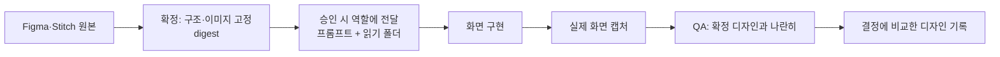

> DevRoster 개발기 시리즈입니다. 전체 목록은 [시리즈 목차](/posts/devroster-series/)에 있습니다.
{: .prompt-info }

화면 품질은 기능 목록에 안 잡힌다. 테스트는 다 통과하는데 화면이 어색한 프로젝트가 그렇다. 원인은 대개 셋 중 하나다. 참고할 화면이 없다, 참고 자료가 있어도 AI가 "참고만" 한다, 만들어 놓고 원본과 비교하지 않는다.

이번 글은 그 셋을 각각 다룬 기록이다. 스킬 카탈로그(T-23), 확정 디자인(T-28), 스킬 목록 한도(T-29)이고 PR은 #126부터 #132, 그리고 #138의 목업 격리다. 0.5.0을 공개한 뒤에 이어진 작업이라 공개된 0.5.0에는 없다.

## 스킬을 고르는 일

참고 화면이 없는 프로젝트에서 화면이 어색해지는 이유는 대개 정해져 있다. 여백이 제각각이고, 강조색이 여러 개고, 그림자가 과하고, 폼 요소가 브라우저 기본 모양이다. 이걸 매번 프롬프트로 설명하는 대신, 검토한 스킬 묶음으로 넣기로 했다.

`MengTo/Skills`(커밋 `3cc9345` 고정)를 읽고 골랐다.

| 구분 | 스킬 |
|---|---|
| 원본 그대로 고정 (2) | `no-ai-design-slop`(디자인 품질 점검), `audit-verify-explain-grade-5`(검증 설명) |
| 검토한 로컬 어댑터 (5) | `audit-ai-design-slop`(화면 감사, 보고만), `workflow-progress-screenshots`(진행 캡처), `design-first-ui-prompting`(화면 설계 틀), `stitched-full-page-capture`(긴 페이지 캡처, 직접 작업용), `animation-systems`(움직임 원칙) |
| 디자인 방향 (6, 하나만 선택) | 베이지 미니멀, 종이 질감 기술형, 따뜻한 종이+주황, 다크 글래스, 다크+초록, 진한 파랑 고대비 |

어댑터에는 원본 위치·commit·고친 이유를 적은 `ADAPTER.md`와 MIT `LICENSE`를 같이 넣었다. 스크립트는 하나도 넣지 않았다. 남의 저장소 스크립트를 앱 안에서 돌리는 순간, 그 스크립트가 무엇을 하는지 우리가 책임져야 한다. 문서만 가져오면 그 책임이 없다.

디자인 방향 어댑터는 맨 앞에 적용 규칙을 두고 그 뒤에 원본 본문을 그대로 붙였다. 규칙은 이렇다.

- 확정 디자인 → 기존 디자인 토큰 → 고른 방향 순서로 적용한다. 방향은 아무것도 정해지지 않았을 때의 기본값이다.
- 홍보 섹션, WebGL, 새 의존성은 요청 없이 넣지 않는다.
- 대비 4.5:1 이상, 움직임 줄이기 설정(`prefers-reduced-motion`)을 지킨다.
- 역할의 쓰기 범위를 넘지 않는다.

선택은 기술 스택과 묶지 않았다. `ui-quality`라는 묶음을 따로 만들어서 React를 쓰지 않는 프로젝트도 고를 수 있게 했다. 디자인 방향은 설정의 "디자인 방향"에서 하나만 고르고, 새 설정 키를 만들지 않고 기존 역할 추가 선택에 저장된다. 기존 프로젝트의 선택값은 바뀌지 않는다.

설치 결과는 원인별로 나눠 보여 준다. 검증된 캐시를 다시 쓴 것(`cache`, 오프라인에서도 됨), 방금 받은 것(`fetched`), DevRoster에 내장된 것(`local`), 그리고 실패 사유다. 스킬 안의 링크가 폴더 밖을 가리키면 설치하지 않는다. 이 검사에서 기존 Android 스킬끼리 서로 참조하는 링크가 막히는 회귀가 나와서, 같은 스킬 묶음 안의 참조는 허용하는 규칙을 넣었다. 보안 검사가 정상 동작을 막을 때는 검사를 느슨하게 하는 게 아니라 범위를 정확히 해야 한다.

카탈로그 71개(기존 58 + 새 13)를 고정 커밋에서 실제로 받아 digest와 링크 검사를 통과하는지 확인했다. 이 확인을 하지 않으면 카탈로그에 적힌 해시는 아무것도 보증하지 않는다.

한계는 남아 있다. 원본 그대로 고정한 두 스킬은 처음 설치할 때 원본 저장소 전체(약 77MB)를 받는다. 필요한 폴더만 받는 기능은 후속이다.

### 스킬 목록이 길어지면

스킬을 넣다 보니 다른 문제가 생겼다. 역할 하나에 붙는 스킬 목록이 길어지면 프롬프트가 스킬 설명으로만 채워진다. 정작 작업 지시가 뒤로 밀린다.

역할당 스킬 목록을 10개에서 12개로 늘렸다. 설명 합계 4,000자 한도는 그대로다. 늘리기만 하면 앞의 문제가 그대로라서 두 가지를 같이 정했다.

첫째, 역할은 목록만 받고 필요한 `SKILL.md`만 연다. 12개의 본문을 전부 프롬프트에 넣는 게 아니라, 이름과 설명을 보고 필요한 것을 고르게 한다.

둘째, 한도에 걸려 빠지는 스킬을 설정 화면에 표시한다. Expo 묶음을 함께 고르면 설명 한도 때문에 `ui-quality` 스킬이 빠지고 경고가 뜬다. 조용히 빠지면 사용자는 그 스킬이 적용된 줄 안다.

이미 승인된 작업의 스킬 목록은 그대로 둔다. 작업을 승인하면 그때의 목록이 실행 기록에 고정되므로, 설정을 바꿔도 진행 중인 작업의 조건이 흔들리지 않는다. 회귀 테스트로 고정했다.

### modern-web-guidance

사용자가 준 최신 웹 플랫폼 지침도 카탈로그에 넣었다. 원문 1~6절(레이아웃, 대화상자·팝오버, 폼, 색·접근성, 성능, 리뷰 점검)을 유지하고 바꾼 점은 `ADAPTER.md`에 적었다.

먼저 지킬 규칙을 맨 앞에 두었다. 우선순위는 확정 화면 디자인 > 요구사항·접근성 > 기존 디자인 시스템 > 이 스킬이다. 시각 값을 정하지 않고, 새 라이브러리·폴리필·빌드 단계를 넣지 않고, 읽기 전용 노드는 제안만 한다. 스킬은 권한·쓰기 범위·승인을 바꾸지 않는다.

브라우저 지원은 프로젝트의 `browserslist` 같은 설정을 먼저 확인하게 했다. 지원이 고르지 않은 기능은 기능 감지와 대체 동작을 갖춘 점진적 향상으로만 쓴다. 기능별 대체 표를 스킬 안에 넣고 검토일(2026-11)을 적었다. 이 표가 없으면 "요즘 브라우저는 다 된다"는 판단이 프로젝트의 실제 지원 범위를 덮는다.

원문에서 바로잡은 것도 있다. 팝오버 메뉴·툴팁의 키보드 동작과 포커스 복귀, `showModal()`이 배경을 이미 inert로 만든다는 점, `overscroll-behavior`가 막는 범위, `:user-invalid`가 매칭되는 시점과 오류 텍스트 연결, 퇴장 전환에 필요한 `display`·`overlay`, `scheduler.yield` 감지(원문 예시는 `scheduler`가 없으면 오류가 난다), 영상 lazy 로딩이다. 지침을 그대로 넣으면 지침대로 코드를 쓰다가 오류가 나는 부분들이다.

## 목업에 방향을 입히기

디자인 방향을 골라도 목업이 그 방향으로 그려지지 않으면 소용없다. 다음 PR(#127)에서 방향별 스타일 테마를 목업 렌더러에 넣었다.

목업 payload에 `style` 키가 생겼다. 값은 여섯 개 중 하나다.

```python
MOCK_STYLES = (
    "clean-minimal-beige-light-mode",
    "light-mode-paper-technical",
    "orange-clean-paper-saas",
    "dark-glass-clean-layout",
    "tech-green-dark-mode-modern",
    "dark-blue-contrasting-clean",
)
```
{: file="domain/studio.py (요약)" }

중요한 결정이 하나 있다. `style`은 DevRoster가 프로젝트 설정의 디자인 방향으로 넣고, 모델이 낸 `style`은 버린다. 모델이 매번 다른 스타일을 골라서 화면마다 테마가 바뀌면 일관성이 없다. `mock-save`로도 바꿀 수 없다.

사용자가 직접 바꾸는 길은 하나다. 목업 툴바에서 스타일을 고르면 캔버스만 미리보기로 바뀌고(Esc나 취소로 되돌림), 확인 대화상자를 거쳐 `POST /api/studio/mock-style`로 저장한다. 같은 명세 버전으로 새 목업 버전을 만들고 기존 의견을 옮긴다. 유효하고 미해결 수정 요청이 없는 화면 확정은 다시 적용한다. 인계 뒤(409)이거나 이미 같은 스타일(400)이면 거부한다.

`style`이 없는 목업은 payload도 digest도 모양도 이전과 같다. 이미 만든 목업과 인계 ZIP이 조용히 달라지지 않게 하려는 것이다. 어두운 테마는 `color-scheme: dark`을 쓰고, 캔버스에 격리 값을 둬서 페이지 스타일이 새지 않게 했다. DevRoster 자체 화면과 글꼴은 그대로다.

인계 문서와 설계 초안에는 "검토용 미리보기 모양이며 추가 범위가 아니다"를 적는다. 목업을 그대로 구현하라는 지시로 읽히면 안 되기 때문이다. 인계 ZIP의 `mockup/index.html`은 저장된 스타일로 그린다.

## 확정 디자인

참고 자료와 확정 디자인은 다른 것이다. 참고는 흔들려도 되고, 확정은 개발이 그대로 따라야 한다. 그런데 화면 참고 자료는 언제든 다시 읽으면 내용이 바뀐다. Figma 프레임을 고치면 같은 링크가 다른 화면이 된다.

그래서 "확정"을 별도의 사실로 만들었다. 화면 참고 자료 상세에서 "확정 디자인으로 지정"을 누르면 그때의 구조와 화면 이미지를 바꿀 수 없게 고정한다.

| 남는 것 | 위치·형식 |
|---|---|
| 고정 기록 | `design-approvals/<id>.json` — 구조를 정규화한 뒤, 잘리기 전에 해시 |
| 화면 이미지 | `design-assets/<sha256>.<ext>` — 읽을 때마다 해시 재확인 |
| 연결 | 한 화면에 확정 디자인 하나 |

지정할 수 있는 것은 Figma는 `node-id`가 있는 프레임 링크, Stitch는 화면 ID가 있는 자료뿐이다. 확정 해제는 프로필에서만 빠지고 기록과 이미지는 근거로 남는다.

원본이 바뀌었는지는 확정 때와 같은 읽기를 다시 해서 같음, 바뀜, 확인 불가 중 하나로 알려 준다. 셋을 구분하는 이유는 "확인할 수 없음"을 "바뀜"이나 "같음" 어느 쪽으로도 처리하면 안 되기 때문이다.

### 이미지도 공격자다

Figma·Stitch에서 받는 이미지와 HTML은 우리가 만든 것이 아니다. 여기에 신경 쓸 것이 몇 가지 있었다.

- 호스트는 정확히 일치해야 한다. Figma는 공식 이미지 주소만 허용한다. Stitch는 실제 응답으로 확인하기 전까지 막아 두고 구조만 고정한다.
- DNS를 한 번만 조회하고 그 주소에 연결한다. TLS는 호스트 이름으로 확인한다. 두 번 조회하면 그 사이에 주소가 바뀔 수 있다(DNS rebinding).
- 리다이렉트는 거부하고 크기 상한을 둔다. 이미지는 PNG·JPEG·WebP만 파일 서명으로 확인하고 SVG는 거부한다. SVG는 스크립트를 담을 수 있는 문서다.
- HTML은 비밀값을 가린 UTF-8 텍스트로만 보관하고, 내려줄 때 `text/plain` 첨부로만 보낸다. 렌더링하지 않는다.

저장하기 전에 정리도 한다. 다운로드 주소와 MCP 이미지에 붙은 서명 쿼리를 캐시·이벤트에 저장하기 전에 떼어 낸다. 저장되는 모든 글(Markdown, HTML, JSON 텍스트)에서 지운다. 서명이 붙은 URL은 그 자체로 일정 시간 유효한 접근 권한이다.

이미지는 가릴 수 없다는 것도 인정해야 한다. 픽셀 안에 비밀값이 찍혀 있으면 마스킹으로 지울 수 없다. 그래서 API 실행기에 이미지를 첨부할 때는 사용자가 확정해서 digest로 고정한 자산만 보낸다. 임의의 화면 캡처를 보내지 않는다.

### 곁다리로 고친 것: 조건 노드

확정 디자인을 넣다가 워크플로 조건 노드의 버그를 찾았다. "디자인 자료 유무"(`yes`/`no`) 조건을 서버가 받아들이지 않았다. 값은 이제 저장된 프로필로 서버가 계산하고, 작업 입력으로는 바꿀 수 없다. 조건을 클라이언트가 정하면 조건 노드가 조건이 아니게 된다. 이 노드가 없는 그래프는 메타데이터와 digest가 그대로다.

## 확정 디자인을 역할에 전달하기

고정만 하고 AI에게 주지 않으면 소용없다. 2/4에서 전달을 붙였다.

워크플로 단계 설정의 "디자인 참고"에 `auto`를 추가했고 이게 기본값이다. 값이 없는 단계도 자동으로 본다. 자동이면 UX/UI, Designer, Frontend, 일반 Developer, QA, Reviewer만 받는다. Figma·Stitch·모두를 고르면 그 제공자의 참고 자료와 확정 디자인을 함께 전달하고, 없음을 고르면 아무것도 전달하지 않는다.

저장된 그래프는 고쳐 쓰지 않는다. 레거시 phase에 적어 둔 값은 유지한다. 설정 파일을 조용히 마이그레이션하면 사용자가 연 적 없는 화면의 동작이 바뀐다. 대신 승인할 때 노드별 전달 목록(`approved_design_delivery`)을 실행 기록에 고정한다.

프롬프트는 정책 문구와 자료를 나눴다.

- 정책(`screen_design_rule`): 우선순위는 확정 화면 디자인 > 요구사항·접근성 > 기존 디자인 시스템 > 일반 참고 자료 > 스타일 방향이다. 벗어난 부분은 "디자인 차이"로 기록하게 한다. 시각 자료가 권한·쓰기 범위·검증 규칙을 바꾸지 못한다고 명시한다.
- 자료(`approved_screen_designs_untrusted`): 구조 요약을 토큰 모드에 따라 4만·2.4만·1.2만 자 안에서 디자인마다 고르게 나누고, 디자인마다 최소 2천 자를 준다.

자료를 `untrusted`로 이름 붙인 이유가 있다. Figma 화면 안의 텍스트에 "이전 지시를 무시하고 …"가 들어 있을 수 있다. 구조 요약은 데이터이고 정책은 우리가 쓴 문장이라는 것을 프롬프트에서 분리해 둔다.

프롬프트를 만들 때마다 고정된 digest로 기록과 이미지를 다시 확인한다. 바뀌었거나 없거나 JSON이 잘렸으면 그 단계를 `POLICY_VIOLATION`으로 막고 "다시 확정한 뒤 새 작업 승인"이라는 복구 방법을 안내한다. 확정이 흔들린 채로 개발을 계속하면 나중에 무엇을 기준으로 만들었는지 알 수 없다.

파일로 넘기는 경로(`adapters/design_delivery.py`)는 더 조심했다.

- 호출마다 예측할 수 없는 새 폴더에 검증한 복사본을 쓴다. 링크를 따라가지 않는 폴더 핸들을 쓴다. 역할이 폴더를 링크로 바꿔 두면 복사가 작업 폴더 밖에 쓰일 수 있기 때문이다.
- 그 단계의 이전 폴더는 지운다. 링크는 링크 자체만 지운다.
- Claude·Gemini는 그 작업 폴더 하나를 읽기 폴더로 받는다. `cli_runner`가 `design-delivery` 바로 아래 폴더 하나만 허용한다.
- Codex는 경로만 받는다. `--add-dir`은 쓰기 권한이 생기므로 주지 않는다.
- API 실행기와 Windows는 구조 요약만 받는다.

문구도 정리했다. 일반·FMEA 역할 문서, `defaults/AGENTS.md`, 스타일 스킬 여섯 개에 같은 우선순위를 적었다. "참고만"이라는 문구는 확정되지 않은 참고 자료에만 해당한다고 범위를 좁혔다. 그리고 스타일 스킬이 `approved_design`(개발 설계 문서)을 확정 디자인으로 부르고 있던 오류를 고쳤다. 이름이 비슷한 두 개념이 스킬 문서에서 섞여 있었다.

역할 문서와 AGENTS 문구가 바뀌었으므로 새로 승인하는 작업의 실행 기록 digest는 달라진다. 확정 디자인이 없는 프로젝트에 대해 보장하는 것은 "디자인 전달 키와 규칙이 생기지 않는다"는 점뿐이다.

## 인계와 ZIP, 그리고 나란히 비교

3/4은 확정 디자인이 어느 Studio 화면에 걸려 있는지 Studio에서 보이게 하고, 개발 인계 기록·설계 초안·ZIP에 함께 남기는 일이다.

연결 규칙은 좁게 잡았다. 한 프로필의 `approved_designs`에서만 출발하고, 지금 명세에 있는 화면만 본다. 다른 프로젝트, 없어진 화면, 해제된 기록은 들어가지 않는다. 이름으로 연결한 것은 같은 이름의 화면이 하나일 때만 인정하고, 여럿이면 `ambiguous`로 표시해 직접 고르라고 한다. 한 화면에 확정 디자인이 둘 이상이면 `conflicts`, 이전 명세 버전에서 만든 연결이면 `revision_changed`다. 엄격 모드(인계, ZIP)는 손상된 기록과 충돌을 복구 안내와 함께 막는다.

기준 프로필이 두 개라는 점도 드러났다. Studio 표시와 ZIP은 작업 공간 프로젝트의 프로필을 쓰고, 개발 인계는 선택한 대상 프로젝트의 프로필을 쓴다. 두 프로젝트가 다르면 화면에 보이는 디자인과 인계로 넘어가는 디자인이 다를 수 있다. 그래서 화면과 미리보기에 각각 기준을 표시한다. 같게 만드는 것이 더 깔끔해 보이지만, 인계는 대상 프로젝트의 요구사항으로 이루어지는 일이라 기준을 바꿀 수 없다.

인계에 남기는 내용은 고정 필드뿐이다(`approval_id`, `content_digest`, `provider`, 화면 ID, `revision_changed`). 메모, 구조, 화면 이름 같은 자유 글자는 넣지 않는다. 남의 화면에 쓴 글이 인계 문서를 타고 다른 프로젝트로 넘어가지 않게 하려는 것이다.

미리보기 뒤에 확정이나 해제가 일어나면 커밋을 `STALE_VERSION`으로 막는다. 미리보기, 커밋, 요구사항 변경의 모든 경로가 같은 기준(`cache_root_for`)을 쓴다.

### QA가 보는 것

4/4에서 구현 화면과 확정 디자인을 나란히 놓았다.

검토 화면의 "실제 화면" 탭에 확정 디자인 이미지가 최신 캡처 옆에 뜬다(1024px 이상에서 두 칸). "이 디자인 폭으로 캡처 너비 맞추기"가 있고, 점검표 안내는 배치, 간격, 색, 글자, 모서리·그림자, 구성 요소, 상태, 폭 여덟 가지다. 화면 검토 결정에는 비교한 디자인을 기록하고, 서버가 그 디자인이 이 작업에 고정된 것인지 다시 검증해서 이벤트에 남긴다. 테이블 스키마는 바꾸지 않았다.

새 조회 경로는 두 개다. `/api/review/designs`는 그 작업에 고정된 것만 보내고, `/api/review/design-image`는 이 작업의 이미지 자산만 보낸다. HTML은 거부하고, 손상되었거나 읽을 수 없으면 409와 복구 안내를 준다. 화면 이름은 지금 등록된 비밀값으로 가린다.

AI 쪽은 확정 디자인을 받는 qa·reviewer 노드에만 `design_comparison_rule`을 넣는다. 점검표, "디자인 비교" 절, 결함은 issue로 보고하게 한다. 역할 문서와 `AGENTS.md`는 바꾸지 않았다. 확정 디자인이 없는 작업의 프롬프트는 그대로다.

API 실행기는 검증된 캐시에서 이미지를 다시 읽어 프롬프트 뒤에 첨부한다.

```python
ATTACH_MAX = 4
ATTACH_BYTES = 1_200_000
ATTACH_PROVIDERS = frozenset({"anthropic_api", "openai_api", "gemini_api"})
```
{: file="domain/design_reference.py (요약)" }

최대 4장, 원본 1,200,000바이트까지다. 요청 한도를 넘으면 뒤에서부터 빼고 그 사실을 안내 문구에 적는다. 확정 디자인이 없으면 요청 바이트가 그대로라는 것을 테스트로 확인했다. xai·exaone·compatible은 텍스트만 보낸다.



## 목업이 페이지 스타일을 물려받던 문제

#138에서 목업 격리를 다시 봤다. 목업 캔버스는 자기 CSS를 쓰는데, 페이지의 전역 초기화가 새어 들어오면 모양이 달라진다. 이전에도 격리 값을 두었지만 비교 범위가 좁았다.

비교를 캔버스 자체, 전체 요소, 35개 속성으로 넓혔다. 그러자 실제 차이가 하나 나왔다. 캔버스 자체가 페이지의 `box-sizing` 초기화를 따르고 있었다. 안쪽 요소는 다 고정했는데 캔버스만 빠져 있었다.

```css
/* T-24 K16: the canvas sets its own box model too, so a page's global reset cannot change it. */
.mock-canvas,.mock-canvas *{box-sizing:border-box}
```
{: file="ui/assets/mock.css (요약)" }

"격리했다"는 말은 무엇을 비교했는지까지 말할 때만 의미가 있다. 속성 목록을 늘리지 않으면 같은 종류의 구멍이 계속 생긴다.

## 검증과 못 한 것

PR마다 전체 테스트를 돌렸다. 스킬 통합 3138건에서 시작해 목업 스타일 3168, 확정 디자인 1~4단계가 3203·3220·3233·3250, modern-web-guidance 3252, 목업 격리 3302건이다. 브라우저 테스트는 1440·1024·768·390px 네 폭에서 가로 넘침을 본다. 새 테스트는 수정 전 코드에서 실패하는 것을 확인했다.

확인하지 못한 것을 적어 둔다.

- 실제 Figma·Stitch 연결로 확인하지 않았다. 모든 테스트는 가짜 응답을 쓴다. Stitch 이미지 주소는 실제 응답 하나로 확인한 뒤 허용할 예정이다.
- 실제 Claude·Codex·Gemini CLI로 이미지를 열람하는 것은 확인하지 않았다. 테스트는 실행기 설정까지만 본다.
- Claude·Gemini의 추가 폴더에 쓰기를 기술적으로 막지는 못했다. 쓰기가 일회용 복사본에만 닿기 때문에 수용 가능한 위험으로 판단했다.
- 실제 AI 생성 품질은 확인하지 않았다. 명세에 따라 실제 AI를 실행하지 않았다.
- 픽셀 자동 비교, 실행 중 화면 자동 캡처는 후속 후보로 남겼다.

## 정리하며

참고와 확정은 다르다. 참고 자료는 언제든 바뀌고, 확정은 digest로 고정해서 쓸 때마다 다시 확인한다. 이 구분이 없으면 "그때 그 화면"을 두 번 다시 만들 수 없다.

그림은 가릴 수 없다. 마스킹은 텍스트에만 통한다. 그래서 이미지는 가리는 대신 대상으로 통제한다. 사용자가 확정한 자산만, 정해진 호스트에서만, 정해진 크기까지만 보낸다.

스킬은 많이 넣는 게 아니라 노드에 들어갈 만큼만 넣는다. 12개와 4,000자라는 숫자보다, 빠지는 스킬을 표시하는 쪽이 중요했다. 조용히 빠지면 적용된 줄 안다.

격리했다는 말은 무엇을 비교했는지까지 말할 때만 의미가 있다. 35개 속성으로 넓히고 나서야 캔버스 하나가 빠진 것을 찾았다.

- 이전: [AI가 테스트를 약하게 만들거나 비밀값을 흘릴 때](/posts/devroster-11-weakened-tests-and-secrets/)
- 처음으로: [시리즈 목차](/posts/devroster-series/)
